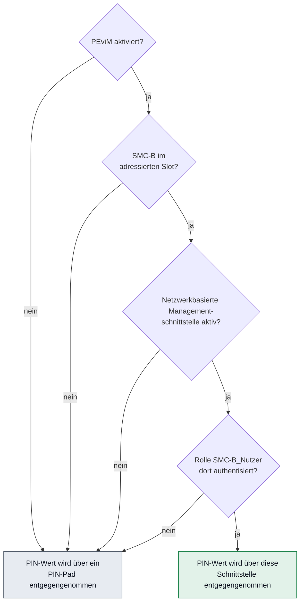
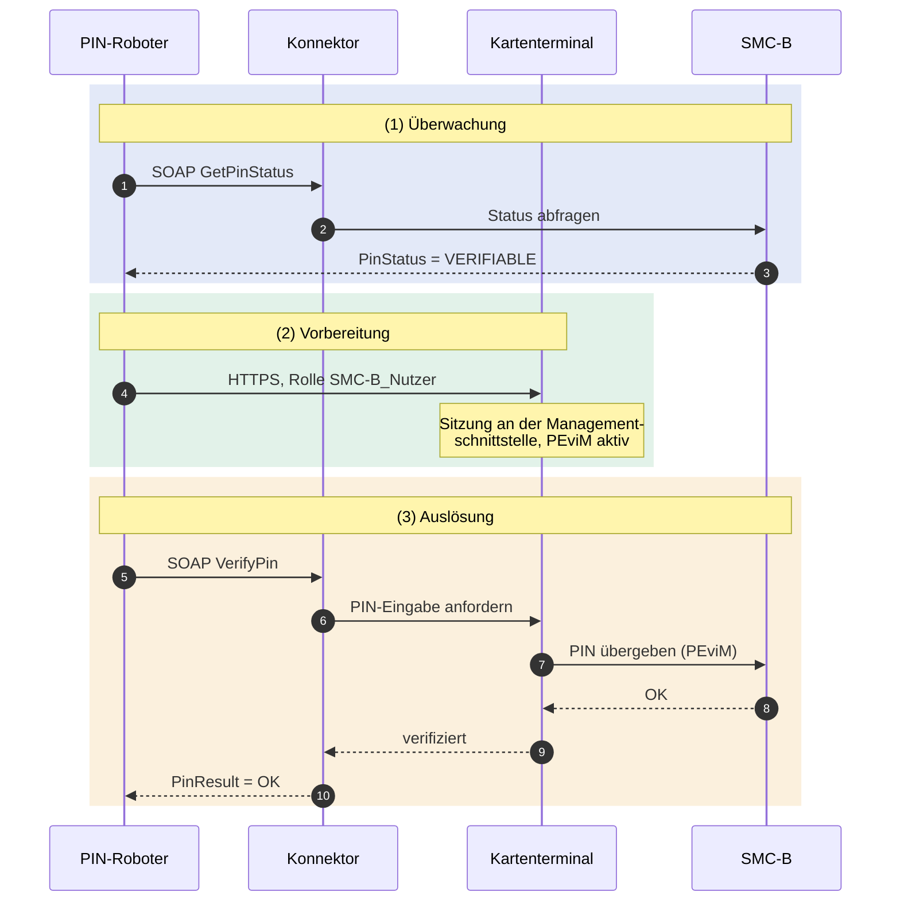

# Fachanalyse: PIN-Verifikation der SMC-B in der Telematikinfrastruktur

Stand: 06.08.2026 · Quellen und Versionen siehe [quellen.md](quellen.md)

Diese Analyse klärt, **wie** der PIN-Roboter fachlich und technisch arbeiten muss.
Jede Aussage ist auf eine Anforderungs-ID der gematik-Spezifikationen
zurückgeführt. Nicht belegte Punkte sind in Abschnitt 8 als offen markiert.

---

## 1. Das Problem in einem Satz

Die SMC-B (Praxis-/Institutionsausweis) muss durch PIN-Verifikation freigeschaltet
sein, damit die Einrichtung TI-Fachdienste nutzen kann. Verliert die Karte ihren
verifizierten Zustand — durch Stromausfall, Neustart, Kartenziehung —, steht der
TI-Betrieb, bis jemand die PIN erneut eingibt.

Der PIN-Roboter **überwacht** diesen Zustand und **stellt ihn automatisiert
wieder her**.

---

## 2. Die drei Wege der PIN-Eingabe

`[gemSpec_KT] 2.4.9.1` unterscheidet drei Verfahren:

| Verfahren | Wo wird die PIN eingegeben? | Relevanz für uns |
|---|---|---|
| **Lokale PIN-Eingabe** (Regelfall) | PIN-Pad des Terminals, in dem die Karte steckt | Das ist der manuelle Ablauf, den wir ersetzen |
| **Entfernte PIN-Eingabe** („remote PIN", `[TR-03114]`) | PIN-Pad eines *zweiten* Terminals; die PIN wird in dessen gSMC-KT verschlüsselt | **Nicht einschlägig** — spezifiziert für Stapel- und Komfortsignatur |
| **PEviM** — PIN-Eingabe via Managementschnittstelle | Über die Netzwerk-/Web-Schnittstelle des Terminals | **Das ist unser Verfahren** |

> **Begriffsfalle:** Hersteller (z. B. CHERRY) beschriften die PEviM-Funktion in
> ihren Oberflächen als „Remote PIN-Eingabe" mit der Option „Webservice". Das ist
> **nicht** die „entfernte PIN-Eingabe" der gematik. Beim Lesen von
> Herstellerdokumentation ist auf diese Doppelbelegung zu achten.

---

## 3. PEviM — die maßgeblichen Anforderungen

Quelle durchgehend `[gemSpec_KT] 2.4.9`, Version 3.17.1.
Eingeführt über Änderung `C_11543` („PEviM, SMC-B PIN-Eingabe via Web-Schnittstelle").

| ID | Inhalt (sinngemäß) | Konsequenz für den PIN-Roboter |
|---|---|---|
| `A_24074` | PEviM ist eine **optionale** Terminal-Funktion (KANN) | **Nicht jedes zugelassene Terminal kann das.** Die Modellunterstützung muss pro Gerät geprüft werden — sie ist eine Einsatzvoraussetzung, kein Automatismus. |
| `A_24075` | Das Terminal setzt die zusätzliche Rolle **`SMC-B_Nutzer`** um; sie darf mit der Rolle Administrator identisch sein | Der PIN-Roboter meldet sich in dieser Rolle an. Ob eine eigene Kennung existiert oder Administratorrechte nötig sind, ist **geräteabhängig** und sicherheitsrelevant. |
| `A_24076`, `A_24077` | PEviM ist im Auslieferungszustand **und nach Werksreset deaktiviert** | Kein Selbstheilungs-Automatismus nach Werksreset. Der Roboter muss diesen Zustand erkennen und melden — er kann ihn nicht selbst beheben. |
| `A_24078` | Aktivieren **nur** durch die Rolle Administrator (`TIP1-A_2981`) | Einmalige Einrichtung durch berechtigtes Personal. Gehört ins Installationshandbuch. |
| `A_24079` | Deaktivieren durch Administrator **oder** `SMC-B_Nutzer`, durch niemanden sonst | Der Roboter darf PEviM abschaltbar machen — als Not-Aus. |
| `A_24157` | Aktivieren/Deaktivieren mindestens über die **direkte** Managementschnittstelle | Ersteinrichtung ist ein Vor-Ort-Schritt. |
| `A_24080` | PEviM ist **ausschließlich für den Kartentyp SMC-B** möglich; das Terminal verhindert die Nutzung für eGK oder HBA | Klare Abgrenzung: eGK- und HBA-PINs sind für dieses Produkt **außerhalb des Scope** und technisch ausgeschlossen. |
| `A_24114` | Der Hersteller muss darauf hinweisen: PIN-Eingabe **nur von Clients**, die unter Kontrolle des Nutzers bzw. seiner Organisation stehen und deren Sicherheit die Organisation durchsetzen kann | **Zentrale Sicherheitsanforderung an unser Produkt.** Der PIN-Roboter *ist* ein solcher Client. Daraus folgt die Härtungspflicht (Abschnitt 6). |

### Vorbedingung für Managementschnittstellen

`[gemSpec_KT]` (Hinweis zu `A_24157`): Im Auslieferungszustand sind gemäß
`TIP1-A_3101` **alle** Managementschnittstellen deaktiviert. Nach Setzen
entsprechender Kennwörter lassen sie sich aktivieren (`TIP_2967`), und zwar nur
über die direkte Managementschnittstelle (`TIP1-A_2968`).

---

## 4. Der technische Ablauf

> **Korrektur vom 10.08.2026.** Dieser Abschnitt beschrieb den Ablauf bis dahin
> so, als **schiebe** der Roboter die PIN ans Terminal. Das ist falsch. Die
> Recherche in den Herstellerspezifikationen hat ergeben: **Das Terminal fragt
> an, der Roboter antwortet.** Er ist ein *PIN-Provider*, kein Auftraggeber.
> Einzelheiten und die Belegstellen:
> [ADR-0011](../adr/0011-pin-uebergabe-ist-eine-anfrage-des-terminals.md).
>
> Die Aussagen unten zur Spezifikation (`A_24080` ff.) bleiben gültig — falsch
> war die Vorstellung davon, wie der PIN-Wert praktisch an die
> Managementschnittstelle gelangt.

Entscheidend ist: **Der PIN-Roboter kann die PIN nicht einfach ins Terminal
schreiben.** Das Terminal nimmt die PIN nur entgegen, während es ein
SICCT-Kommando des Konnektors bearbeitet — und es **fordert sie dann aktiv an**
bei dem Dienst, der sich zuvor als PIN-Provider angemeldet hat. Beide Seiten
müssen zusammenspielen.

### 4.1 Verhalten des Terminals (`A_24081`)

Bei einem `SICCT PERFORM VERIFICATION` mit eingebettetem `VERIFY`-Kartenkommando
ermittelt das Terminal die Quelle des PIN-Werts nach dieser Prüfkette:

> **Alle vier Bedingungen müssen gelten.** Fällt eine weg, verlangt das Terminal
> die Eingabe am Gerät — der Roboter kann dann nichts ausrichten.

Analog `A_24082` für `SICCT MODIFY VERIFICATION DATA` mit
`CHANGE REFERENCE DATA` — das ist der **PIN-Änderungs**-Fall.
`A_24110`/`A_24111`: Enthält das Kommando kein VERIFY bzw. kein CHANGE REFERENCE
DATA, gilt immer PIN-Pad.

> **Architektonisch folgt daraus:** Der Roboter muss **zum Zeitpunkt des
> Kommandos** bereits als `SMC-B_Nutzer` an der Managementschnittstelle
> authentisiert und verbunden sein. Die Sitzung wird also *vor* dem Auslösen
> aufgebaut — die Reihenfolge ist nicht beliebig.

### 4.2 Auslösung über den Konnektor (`[gemSpec_Kon] 4.1.5.5`)

Der Konnektor bietet als Basisanwendung Kartendienst an der Außenschnittstelle
u. a. die SOAP-Operationen `VerifyPin`, `ChangePin`, `UnblockPin`, `GetPinStatus`
(`TIP1-A_4586` ff.).

**`GetPinStatus`** (`TIP1-A_4589`, TAB_KON_051) — die Grundlage der Überwachung:
- Aufruf: `Context` (MandantId, CsId, WorkplaceId, ggf. UserId), `CardHandle`, `PinTyp`
- Für SM-B ist `PinTyp` = **`PIN.SMC`**
- Rückgabe `PinStatus`, verpflichtende Werte:

| Wert | Bedeutung | Reaktion des Roboters |
|---|---|---|
| `VERIFIED` | bereits verifiziert | nichts tun — Sollzustand |
| `VERIFIABLE` | Echt-PIN, noch nicht verifiziert | **Auslöser für die Verifikation** |
| `TRANSPORT_PIN` | Transport-PIN noch nicht geändert | Nur manuell lösbar → melden |
| `EMPTY_PIN` | Leer-PIN | melden |
| `BLOCKED` | gesperrt | **Alarm** — nur per PUK lösbar |
| `DISABLED` | PIN-Schutz ausgeschaltet | melden |

- `LeftTries` liefert bei `VERIFIABLE` die verbleibenden Versuche, bei gesperrter PIN 0.

**`VerifyPin`** (`TIP1-A_4587`, TAB_KON_047) — die Auslösung:
- Unterstützt **nur** HBAx und SM-B; für die eGK ausdrücklich nicht zulässig
  (sonst Fehler `4209`)
- Für SM-B ist `PinTyp` = `PIN.SMC`
- Die Verifikation erfolgt „mandatorisch": sie wird unabhängig vom bereits
  erreichten Sicherheitsstatus immer durchgeführt (`TUC_KON_012`)
- Rückgabe `PinResult`: `OK`, `REJECTED` (mit `LeftTries`), `ERROR`,
  `WASBLOCKED`, `NOWBLOCKED`, `TRANSPORT_PIN`
- Relevanter Fehlercode: **`4078` — PIN-Eingabe über das Clientsystem ist nicht
  zugelassen** (Security Error). Dieser Fall muss sauber behandelt und dem
  Betreiber verständlich gemeldet werden.

Das Zielterminal ergibt sich aus **Mandanten-ID und Arbeitsplatz-ID** des
Aufrufkontexts. Der Konnektor muss also für den PIN-Roboter als Clientsystem
konfiguriert sein (Mandant, Clientsystem-ID, Arbeitsplatz).

### 4.3 Zusammengesetzter Ablauf

Schritt 5 ist nicht optional: Nur der erneute Statusabruf belegt den Erfolg.

---

## 5. Systemlandschaft

| Komponente | Rolle | Schnittstelle zum PIN-Roboter |
|---|---|---|
| **eHealth-Kartenterminal** | hält die SMC-B, führt PEviM aus | HTTPS-Managementschnittstelle / REST-API, Rolle `SMC-B_Nutzer` |
| **Konnektor** (Einbox) | Zugang zur TI, sendet SICCT-Kommandos | SOAP-Außenschnittstelle, Kartendienst |
| **Highspeed-Konnektor (HSK)** | skalierbarer Konnektor für Rechenzentrum/Klinik, ersetzt viele Einbox-Konnektoren; erste Zulassung 2023 | voraussichtlich gleiche SOAP-Außenschnittstelle — **zu verifizieren** |

Für den Einsatz in Kliniken ist der HSK der Regelfall: eine Instanz bedient viele
Terminals. Das Mengengerüst des PIN-Roboters muss darauf ausgelegt sein.

---

## 6. Sicherheitsbewertung — der kritische Punkt

Der PIN-Roboter muss die SMC-B-PIN **im Klartext an das Terminal übergeben
können**. Er muss sie also vorhalten. Das ist der sicherheitskritische Kern des
gesamten Produkts.

`A_24114` ist dabei kein Nebensatz, sondern die Bedingung, unter der das
Verfahren überhaupt zulässig ist: die PIN-Eingabe darf nur von Clients aus
erfolgen, die unter der Kontrolle der Organisation stehen und **deren Sicherheit
diese durchsetzen kann**. Der PIN-Roboter-Container ist genau ein solcher Client.
Damit trägt unser Produkt diese Zusicherung — sie muss technisch eingelöst werden.

Daraus abgeleitete, nicht verhandelbare Architekturanforderungen:

1. **PIN niemals im Klartext persistieren.** Verschlüsselte Ablage mit einem
   Schlüssel, der nicht im Image und nicht im Repository liegt.
2. **PIN nie in Logs, Fehlermeldungen, Stacktraces, Metriken oder Backups.**
   Technisch erzwungen, nicht durch Disziplin.
3. **Verschlüsselter Transport** zum Terminal und zum Konnektor (TLS), mit
   geprüften Zertifikaten — kein pauschales Deaktivieren der Zertifikatsprüfung.
4. **Zugriffsschutz auf die Weboberfläche** des PIN-Roboters mit Rollen: Wer die
   PIN hinterlegen darf, ist eine andere Rolle als wer den Status ansieht.
5. **Lückenloses Audit-Log**: wer hat wann welche PIN hinterlegt oder geändert,
   welche Verifikation wurde wann für welche Karte ausgelöst und mit welchem
   Ergebnis. Ohne PIN-Werte.
6. **Fehlversuchsschutz**: `LeftTries` wird vor jedem Versuch ausgewertet. Bei
   sinkender Zahl wird **abgebrochen und alarmiert**, nicht weiterprobiert —
   sonst sperrt der Roboter die Karte selbst. Das ist die gefährlichste
   Fehlfunktion, die dieses Produkt haben kann.
7. **Not-Aus**: Die Automatik muss sich sofort abschalten lassen.

> **Bewertung der Zulässigkeit:** Das Verfahren als solches ist von der gematik
> spezifiziert (`[gemSpec_KT] 2.4.9`) und ausdrücklich für die SMC-B vorgesehen —
> es handelt sich nicht um eine Umgehung. Vergleichbare Funktionen sind am Markt
> etabliert (automatische PIN-Verifikation im TI-Gateway). Eine **ausdrückliche
> gematik-Aussage zur dauerhaften Speicherung der PIN in einem Drittprodukt**
> konnte in der Recherche vom 06.08.2026 nicht gefunden werden. Das ist als
> offener Punkt zu behandeln (Abschnitt 8), nicht als stillschweigende Erlaubnis.

---

## 7. Was das für den Produktzuschnitt bedeutet

- Der PIN-Roboter ist **kein** Ersatz für den Konnektor und **kein** Primärsystem.
  Er ist ein zusätzliches **Clientsystem** am Konnektor plus ein
  **Management-Client** am Kartenterminal.
- Er benötigt zwingend: einen Konnektor, der ihn als Clientsystem kennt, und
  Terminals, die PEviM unterstützen und aktiviert haben.
- Kartentyp-Scope: **ausschließlich SMC-B** (`A_24080`). eGK und HBA sind
  technisch ausgeschlossen.
- Zwei klar trennbare Funktionsblöcke:
  **(a) Überwachung** — funktioniert mit jedem Terminal, benötigt nur den
  Konnektor. Liefert für sich genommen schon Nutzen (Transparenz, Alarmierung).
  **(b) Automatische Freischaltung** — benötigt zusätzlich PEviM.
  Diese Trennung ist auch die naheliegende Ausbaustufung des Produkts.

---

## 8. Offene Punkte — bewusst nicht geraten

| # | Offener Punkt | Klärungsweg |
|---|---|---|
| 1 | Welche zugelassenen Terminal-Modelle unterstützen PEviM? | Herstellerangaben + gematik-Zulassungsliste/Produkttypsteckbrief `[gemProdT_KT]` |
| 2 | Konkrete REST-/HTTPS-Endpunkte der Terminals (CHERRY ST-1506, Ingenico ORGA). Die Hersteller-API-Dokumentation war öffentlich nicht abrufbar | Herstellerdokumentation anfordern; CHERRY nennt „API-Version 3.0" |
| 3 | Wie authentisiert sich die Rolle `SMC-B_Nutzer` konkret — eigene Kennung oder Admin-PIN? Geräteabhängig | Herstellerdokumentation, Test am Gerät |
| 4 | Bietet der HSK dieselbe SOAP-Außenschnittstelle? Besonderheiten bei Mandanten/Arbeitsplätzen | `[gemSpec_Kon]` + HSK-Zulassungsdokument |
| 5 | Wie authentisiert sich ein Clientsystem am Konnektor (TLS-Client-Zertifikat / Basic Auth), und wie wird es dort eingerichtet? | `[gemSpec_Kon]`, `[gemILF_PS]` |
| 6 | Unter welchen Bedingungen tritt Fehler `4078` auf? | `[gemSpec_Kon]`, `TUC_KON_012` |
| 7 | Gibt es eine gematik-Position zur dauerhaften PIN-Speicherung in Drittprodukten? | gematik-Fachportal, ggf. direkte Anfrage |
| 8 | Wie erfährt der Roboter zeitnah vom Statusverlust — Polling-Intervall oder Ereignis? Bietet der Konnektor Events/Subscriptions? | `[gemSpec_Kon]` (Ereignisdienst) |
| 9 | Testumgebung: Gibt es Testkarten/Testkonnektor für die Entwicklung ohne Produktivkarten? | gematik-Fachportal (Testkarten SMC-B sind dokumentiert) |
