# Architekturkonzept PIN-Roboter

- **Stand:** 07.08.2026
- **Status:** **In Umsetzung** — die Bausteinsicht entspricht dem gebauten Zustand
- **Grundlage:** [Anforderungskatalog](01-anforderungskatalog.md), ADR-0001 bis ADR-0007

> **Verhältnis zu den anderen Dokumenten.** Dieses Konzept beschreibt Bausteine,
> Verantwortlichkeiten und Abläufe. **Wie** sie gebaut sind und warum so, steht in
> [docs/03-umsetzung/](03-umsetzung/); wo beide auseinanderlaufen, gilt das
> Umsetzungsverzeichnis, und dieses Dokument ist nachzuziehen.
>
> Der Entwurf entstand technologieneutral. Die Stack-Entscheidung (ADR-0006) hat
> ihn **ausgefüllt, nicht verändert** — die Bausteine, die Vertrauensgrenze und
> die Abläufe sind unverändert geblieben. Das ist ein gutes Zeichen für den
> Schnitt.

## Umsetzungsstand (09.08.2026)

| Baustein | Stand |
|---|---|
| **Standort-Agent** | Überwachung, Sicherungslogik, PEviM-Ablauf, Registrierung — läuft |
| **Zentrale** | Oberfläche, Anmeldung mit TOTP, Fachprotokoll, Alarme, Gruppen, Export, Bestandsverwaltung, Benutzerverwaltung — läuft |
| **Simulator** | Konnektor und Terminals mit Brainpool-TLS — läuft, ersetzt echte Hardware **nicht** |
| Herstellerkapselung | angelegt, bisher nur eine Umsetzung (CHERRY-artig) |
| Bestandsverwaltung | Konnektoren und Terminals erfassen, ändern, löschen (FA-GER-010/020) — läuft |
| Geräte-Zugangsdaten | verschlüsselt in der Zentrale (AES-GCM), Abgrenzung zur PIN in ADR-0008 |
| Bedienbarkeit bei 5.000 Geräten | vollständig; **gemessen** bei 5.000 Terminals und 5 Mio Protokolleinträgen ([Messbericht](00-referenzen/messung-leistung-mengengeruest.md)) — erste Seite 14 ms, Zielwert 1 s |
| Automatische Terminal-Ermittlung | Agent ermittelt, Zentrale gleicht ab, Übernahme einzeln oder als Auswahl — nur nach Bestätigung (FA-GER-030, FA-GER-035) |
| Informationsmodell des Konnektors | wird gelesen; Aufrufkontext steht **zur Auswahl** statt abgetippt (FA-GER-035), Freitext bleibt möglich |
| Mandantentrennung | **durchgesetzt** für Bestand, Ermittlung, Protokoll, Export, Alarme, Gruppen und Benutzerliste — zentral über `Geltungsbereich` als Pflichtparameter ([Umsetzung](03-umsetzung/10-mandantentrennung.md)). Ergänzt um Rechte je Ebene ([Umsetzung](03-umsetzung/11-rechte-je-ebene.md)) |
| Betriebsdokumentation | [docs/04-betrieb.md](04-betrieb.md) — Wiederherstellung durchgeführt und als Nachweis automatisiert |
| Sicherheit und Datenschutz | [docs/05-sicherheit-datenschutz.md](05-sicherheit-datenschutz.md) — TOMs belegt, Lücken benannt |
| Benutzerverwaltung | Einladungen statt gesetzter Kennwörter, zweiter Faktor zurücksetzbar, Deaktivieren statt Löschen ([Umsetzung](03-umsetzung/12-benutzerverwaltung.md)) |
| Update-Manager | **teilweise:** Versionen werden erkannt und angezeigt (FA-UPD-010, [Umsetzung 25](03-umsetzung/25-neue-versionen-erkennen.md)). Die geführte Ausführung (FA-UPD-020) fehlt |
| Firmware-Rollout | **nicht umgesetzt** (V2 laut ADR-0004) |
| Protokollansicht | Paginierung, 50 Zeilen je Seite; bei 5 Mio Einträgen 110 ms. **Grenze:** sehr tiefes Blättern (ab ~Seite 75.000) überschreitet 1 s |

Umgesetzter Stack: **Java 21**, BouncyCastle, Javalin, PostgreSQL, HTMX —
rund 18.000 Zeilen, **264 Modultests, 329 Systemnachweise** — im letzten Vollauf alle grün.

Seit dem 07.08.2026 hinzugekommen:

| Baustein | Stand |
|---|---|
| PIN-Hinterlegung und PIN-Änderung über die Oberfläche | läuft; die Zentrale sieht die PIN **nie im Klartext** ([ADR-0009](adr/0009-pin-hinterlegen-ueber-die-oberflaeche.md)) |
| Benachrichtigung per E-Mail | läuft, mit Sammelfenster gegen Mailfluten (FA-ALA-020) |
| Geräte-Zeitstrahl und Vorgangsansicht | läuft (FA-PRO-050/060) — damit sind alle vier Sichten aus ADR-0005 vorhanden |
| Prüfintervall je Gerätegruppe | wirkt nachweislich im Agenten (FA-UEB-010) |
| KSR-Zustand „aktualisierend" | wird erkannt, keine PIN-Verifikation währenddessen (`[gemSpec_Kon] 4.3.10`) |
| Versionsprüfung gegen die Registry | läuft (FA-UPD-010) |
| Startkonto aus der Konfiguration | läuft (FA-BEN-035) — der Zugang überlebt einen Datenverlust |
| Einheitlichkeit der Oberfläche | erzwungen statt gepflegt: `Bedienelemente` mit Pflicht-Kurzhinweis, Abstandsraster, 20 maschinelle Prüfpunkte ([Umsetzung 26](03-umsetzung/26-ux-refactoring.md)) |

> Umsetzungsstand je Anforderung: [docs/01a-umsetzungsstand.md](01a-umsetzungsstand.md).
> Was der PO entscheiden muss: [docs/ENTSCHEIDUNGEN-PO.md](ENTSCHEIDUNGEN-PO.md).

> **Unverändert offen und weiterhin der wichtigste Punkt:** Alle Nachweise
> laufen gegen den selbstgebauten Simulator. Die in
> [ADR-0007](adr/0007-simulierte-endpunkte-und-teststrategie.md) geforderte
> Kalibrierung an echter Hardware steht aus.

---

## 1. Aufgabe und Qualitätsziele

Der PIN-Roboter überwacht eHealth-Kartenterminals und stellt den verifizierten
Zustand der eingelegten SMC-B automatisiert wieder her (Verfahren PEviM,
`[gemSpec_KT] 2.4.9`). Ergänzend verwaltet er Firmware-Stände und rollt Firmware
nach Zeitplan aus.

Die fünf Qualitätsziele in der Reihenfolge ihres Gewichts. Bei Zielkonflikten
gewinnt das höher stehende:

| # | Ziel | Woran es sich entscheidet |
|---|---|---|
| 1 | **Keine Kartensperrung** | Das System darf eine SMC-B unter keinen Umständen selbst sperren (FA-PIN-030). Alles andere ist nachrangig. |
| 2 | **Vertraulichkeit der Geheimnisse** | PIN und Terminal-Zugänge sind nirgends im Klartext greifbar (NFA-SIC-010). |
| 3 | **Betriebssicherheit** | Der TI-Zugang der Einrichtung darf nicht an diesem Produkt scheitern. |
| 4 | **Nachvollziehbarkeit** | Jede selbsttätige Handlung ist im Nachhinein erklärbar (ADR-0005). |
| 5 | **Skalierbarkeit** | Dieselbe Software trägt 3 und 5.000 Terminals (NFA-LEI). |

**Bedienbarkeit** ist kein eigenes Ziel dieser Liste, sondern Bedingung für 3 und
4: Ein System, dessen Zustand niemand versteht, ist weder betriebssicher noch
nachvollziehbar.

---

## 2. Randbedingungen

| | |
|---|---|
| Auslieferung | Docker, ein Compose-Stack, Registry GHCR (privat) |
| Plattformen | Linux, Windows, macOS · `linux/amd64` und `linux/arm64` |
| Betrieb | On-Premise beim Kunden, Betreiber ohne IT-Personal |
| Fremdsysteme | Konnektor / HSK (SOAP), Kartenterminal (HTTPS-Managementschnittstelle) |
| Verbindlich | gematik-Spezifikationen; PEviM nur für SMC-B (`A_24080`) |
| Sprache | Deutsch in Oberfläche, Meldungen und Dokumentation |

---

## 3. Kontextabgrenzung

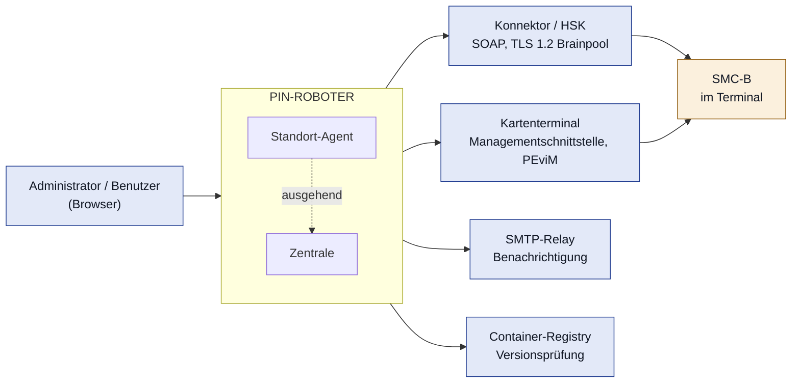


### Externe Schnittstellen

| Partner | Richtung | Zweck | Wesentliche Operationen |
|---|---|---|---|
| **Konnektor / HSK** | ausgehend, SOAP | Status ermitteln, Verifikation auslösen, Bestand ermitteln | `GetPinStatus`, `VerifyPin`, `GetCards`, `GetCardTerminals`, `GetResourceInformation`; später `ChangePin` |
| **Kartenterminal** | ausgehend, HTTPS | PIN liefern (Rolle `SMC-B_Nutzer`), Firmware-Stand lesen, Firmware einspielen | herstellerspezifische Management-/REST-Schnittstelle |
| **GHCR** | ausgehend, HTTPS | Produktversionen erkennen und beziehen | Registry-API, authentifiziert |
| **SMTP** | ausgehend | Benachrichtigungen | optional |
| **Browser** | eingehend, HTTPS | Bedienung | — |

**Bemerkenswert:** Das Produkt hat **genau eine eingehende Schnittstelle** — die
Weboberfläche. Alles andere baut es selbst auf. Das ist eine bewusste
Architektureigenschaft: Sie hält die Angriffsfläche klein und erspart im
Kundennetz eingehende Firewall-Freigaben.

---

## 4. Lösungsstrategie

| Problem | Lösungsansatz |
|---|---|
| Zwei Betriebsarten, eine Software | Schnitt entlang der **Netzgrenze**: Zentrale und Standort-Agent (ADR-0002) |
| Terminals in fremden Netzen | Agent baut die Verbindung **ausgehend** auf |
| PIN darf das Praxisnetz nicht verlassen | PIN liegt **ausschließlich beim Agenten**, nie in der Zentrale |
| 3 bis 5.000 Terminals | Last liegt beim Agenten; die Zentrale sieht nur Zustandsmeldungen |
| Karte darf nie gesperrt werden | Verifikation ist **kein wiederholbarer Vorgang** — Sonderweg in der Fehlerbehandlung |
| Mandantentrennung darf nicht vergessen werden | zentral erzwungen, nicht je Abfrage |
| Protokoll darf nicht explodieren | nur Zustandsänderungen, eigenes Speicherbudget (ADR-0005) |

---

## 5. Bausteinsicht

### 5.1 Ebene 1 — Die beiden Bausteine

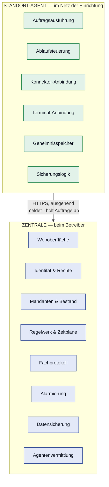


**Die Trennlinie ist die Vertrauensgrenze.** Sie verläuft nicht nach technischer
Schichtung, sondern danach, wo Geheimnisse liegen dürfen: Die Zentrale steuert
und protokolliert, der Agent besitzt und handelt.

| | **Zentrale** | **Standort-Agent** |
|---|---|---|
| Kennt Geheimnisse | nein | ja (PIN, Terminal-Zugänge) |
| Spricht mit Geräten | nein | ja |
| Hält Bestand und Historie | ja | nur was er lokal braucht |
| Läuft ohne den anderen | ja (eingeschränkt) | **ja, vollständig** (FA-AGT-030) |
| Anzahl je Installation | 1 | 1 bis n |

### 5.2 Zentrale — Komponenten

| Komponente | Verantwortung |
|---|---|
| **Weboberfläche** | Darstellung, Bedienung, Barrierefreiheit |
| **Identität & Rechte** | Anmeldung, TOTP, Sitzungen, Rollen, Onboarding |
| **Mandanten & Bestand** | Serviceorganisationen, Einrichtungen, Gruppen, Geräte, Karten |
| **Regelwerk & Zeitpläne** | Prüfintervalle, Rollout-Pläne, Zeitfensterberechnung, Not-Aus |
| **Auftragsvergabe** | erzeugt Aufträge für Agenten, verfolgt deren Zustand |
| **Fachprotokoll** | Ereignisse aufnehmen, abfragen, exportieren, rotieren |
| **Alarmierung** | Alarmzustände führen, benachrichtigen, quittieren |
| **Update-Manager** | Versionen erkennen, Freigabe, Ausführung, Rollback (ADR-0001) |
| **Agentenvermittlung** | Registrierung, Verbindungen, Versionsabgleich |

#### Wie sich das im Quelltext wiederfindet

Die Komponenten oben sind fachliche Zuständigkeiten, keine Klassen. Die
Abbildung auf den Code:

| Komponente | Klassen |
|---|---|
| Weboberfläche | `*seiten.java`, `Bedienelemente`, `stil.css`, `oberflaeche.js` |
| Identität & Rechte | `Benutzerverwaltung`, `Rechte`, `Geltungsbereich`, `Einladungen`, `Startkonto`, `Anmeldebremse` |
| Mandanten & Bestand | `Organisationsverwaltung`, `Bestandsverwaltung`, `Gruppenverwaltung`, `Ermittlung` |
| Regelwerk & Zeitpläne | `Gruppenverwaltung` (Intervalle), `Zentrale` (Not-Aus) |
| Auftragsvergabe | `Pinverwaltung` |
| Fachprotokoll | `Fachprotokoll`, `Ereignis`, `Speicherwaechter`, `Tabellenmappe`, `Pseudonymisierung` |
| Alarmierung | `Alarmverwaltung`, `Benachrichtigung`, `Mailversand` |
| Update-Manager | `Versionspruefung` |
| Agentenvermittlung | `Agentenverwaltung` |

`Zentrale.java` selbst hält die Routen, den Zustand im Speicher und die
Hintergrundaufgaben. Die 81 Routen sind in zehn thematische Methoden gebündelt
(`routenAnmeldung`, `routenBestand`, …); bis zum 09.08.2026 standen sie in
**einer** Methode mit 1450 Zeilen. Einzelheiten:
[Entwicklerhandbuch](07-entwicklerhandbuch.md).

### 5.3 Standort-Agent — Komponenten

| Komponente | Verantwortung |
|---|---|
| **Auftragsausführung** | Aufträge annehmen, ausführen, Ergebnis melden |
| **Ablaufsteuerung** | Reihenfolge, Nebenläufigkeit, Lastbegrenzung je Konnektor |
| **Konnektor-Anbindung** | SOAP-Aufrufe, Aufrufkontext, Fehlerübersetzung |
| **Terminal-Anbindung** | HTTPS-Sitzung, Rolle `SMC-B_Nutzer`, PIN-Lieferung, Firmware |
| **Geheimnisspeicher** | verschlüsselte Ablage von PIN und Zugängen |
| **Ereignispuffer** | Ereignisse zwischenspeichern, nach Wiederverbindung nachliefern |
| **Sicherungslogik** | `LeftTries` prüfen, Not-Aus beachten, Zustand „aktualisierend" beachten |

> **Die Sicherungslogik sitzt bewusst im Agenten, nicht in der Zentrale.** Sie
> muss auch dann greifen, wenn die Verbindung zur Zentrale gerade fehlt. Eine
> Schutzfunktion, die eine Netzverbindung voraussetzt, ist keine.

### 5.4 Herstellerkapselung — auf beiden Seiten

Herstellerspezifisches Verhalten tritt an **zwei** Stellen auf. Beide werden nach
demselben Muster hinter einer einheitlichen inneren Schnittstelle gekapselt:

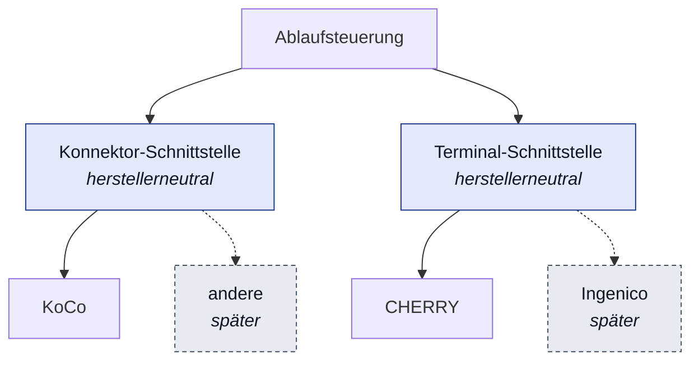


**Terminal-Seite:** Ein neuer Hersteller ist eine neue Umsetzung der Schnittstelle
plus ein Eintrag in der Gerätematrix (NFA-QS-030) — **ohne Eingriff in die
Ablaufsteuerung**.

**Konnektor-Seite:** Hier ist zusätzlich zwischen zwei Schnittstellenarten zu
unterscheiden (ADR-0006):

- Die **Fachschnittstelle** (Kartendienst, `[gemSpec_Kon] 4.1.5.5`) ist von der
  gematik spezifiziert und im Grundsatz herstellerübergreifend gleich. Sie trägt
  die Kernfunktion. Dass ein bestimmter Hersteller sich spezifikationsgemäß
  verhält, gilt erst nach Messung am Testaufbau als belegt.
- Die **Webadmin-Schnittstelle** ist herstellerspezifisch und steht uns nur für
  **KoCo Konnektor und KoCo HSK** zur Verfügung (in den relevanten Punkten
  identisch, daher **eine** Anbindung). Funktionen, die darauf beruhen, sind
  optional: Bei einem Konnektor ohne verfügbare Webadmin-Anbindung entfallen sie
  und werden in der Oberfläche als nicht verfügbar ausgewiesen — die
  Kernfunktion bleibt davon unberührt.

Diese Trennung ist die wichtigste Erweiterungsstelle des Systems. Sie entscheidet
darüber, ob ein weiterer Hersteller ein überschaubarer Zusatz ist oder ein
Umbau.

---

## 6. Laufzeitsicht

### 6.1 Automatische Verifikation — der Kernablauf

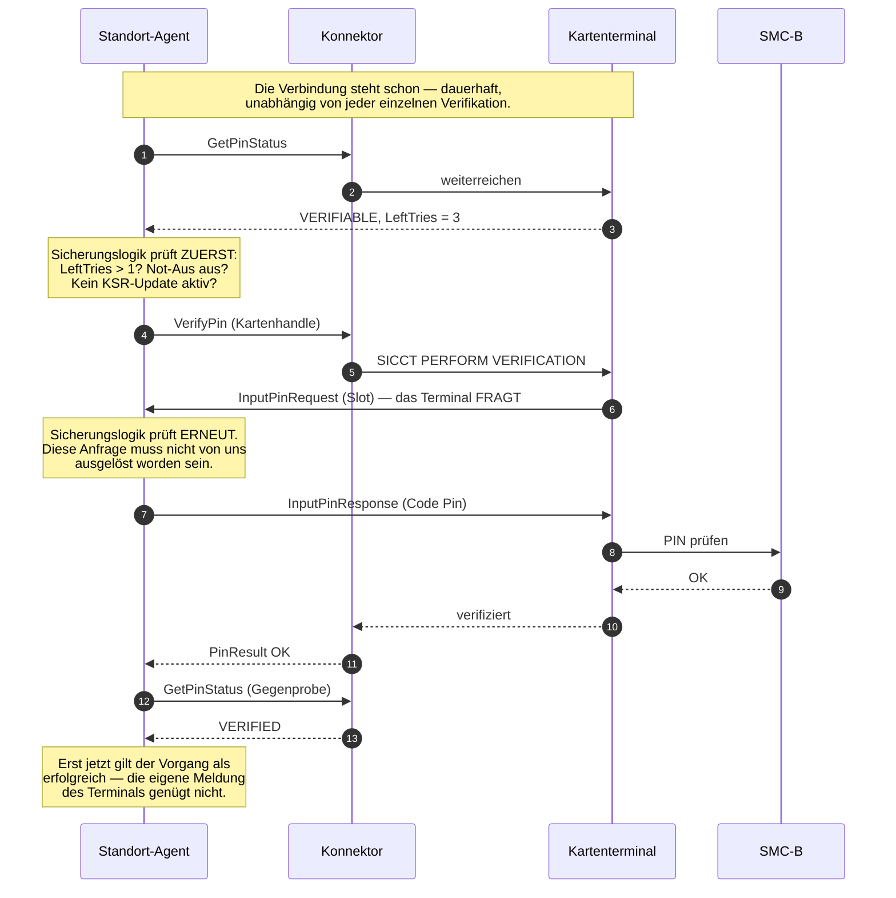


**Drei Dinge sind an diesem Ablauf nicht verhandelbar:**

1. Die **Verbindung zum Terminal muss vor dem `VerifyPin` stehen.** `A_24081`
   verlangt, dass die Rolle `SMC-B_Nutzer` beim Eintreffen des SICCT-Kommandos
   bereits authentisiert ist; die angemeldete Verbindung zur Remote SMCB API ist
   genau das. Die Reihenfolge ist Teil der Spezifikation, nicht der
   Bequemlichkeit.
2. Die **Sicherungslogik greift beim Beantworten**, nicht nur beim Auslösen.
   Solange die Verbindung steht, kann jede Stelle am Konnektor eine PIN-Anfrage
   auslösen — die zweite Prüfung ist dann die einzige Bremse.
3. Die **abschließende Statusabfrage ist Pflicht.** Ein `PinResult = OK` ist die
   Antwort auf einen Aufruf; erst `VERIFIED` ist der bestätigte Zustand.

> Umgesetzt am 10.08.2026 nach
> [ADR-0011](adr/0011-pin-uebergabe-ist-eine-anfrage-des-terminals.md).
> Einzelheiten:
> [03-umsetzung/29](03-umsetzung/29-remote-smcb-api.md).

### 6.2 Verhalten bei `PinResult = REJECTED`

```
REJECTED  →  Automatik für diese Karte ANHALTEN
          →  Alarm mit verbleibenden Versuchen
          →  Ereignis protokollieren
          →  KEIN zweiter Versuch
```

Das ist der einzige Ort im System, an dem ein Fehlschlag **nicht** wiederholt
wird. Überall sonst gilt Wiederholung mit wachsendem Abstand — hier wäre sie der
direkte Weg zur gesperrten Karte. Der Sonderweg ist im Code als solcher zu
kennzeichnen und durch einen verpflichtenden Test abgesichert (FA-PIN-030).

### 6.2a Wie Agent und Zentrale miteinander reden

**Der Agent ist ausschließlich Client.** Er öffnet keinen Port — im ganzen
Agentenmodul gibt es keine Serverklasse. Alles läuft ausgehend von ihm, im
Grundtakt (Vorgabe 10 s).

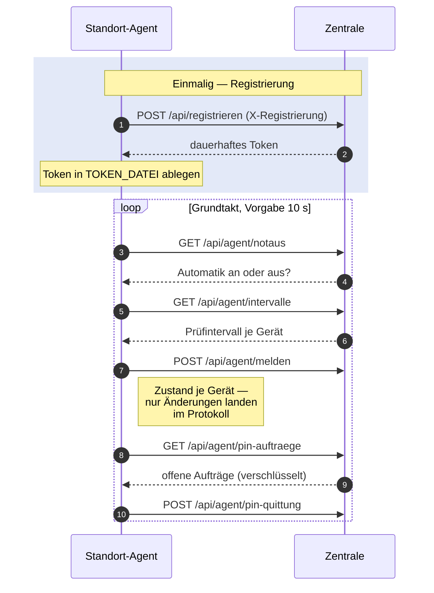

> **Auch Befehle werden abgeholt, nicht zugestellt.** Wer in der Oberfläche eine
> PIN hinterlegt, legt einen Auftrag ab; der Agent findet ihn beim nächsten
> Takt. Das kostet Latenz — und erspart jeder Praxis eine eingehende
> Firewall-Freigabe.

Der Agent hat **keine Oberfläche**. Er steht im Praxisnetz, nah an den Geräten,
und ist der einzige Ort, an dem die PIN im Klartext existieren kann. Jede
Oberfläche dort wäre eine zusätzliche Angriffsfläche an der empfindlichsten
Stelle. Konfiguriert wird er über Umgebungsvariablen, sichtbar ist er in der
Zentrale.

---

### 6.2a-2 Welche Protokolle wo gesprochen werden

Eine Verwechslung, die sich hartnäckig hält: **Der PIN-Roboter spricht kein
SICCT.**

| Strecke | Protokoll | Wer spricht |
|---|---|---|
| Browser → Zentrale | HTTP(S) | wir |
| Agent → Zentrale | HTTP(S), ausgehend | wir |
| Agent → Konnektor | SOAP über TLS 1.2 (`brainpoolP256r1`) | wir |
| Agent → Kartenterminal | HTTPS, Managementschnittstelle | wir |
| Agent ↔ Kartenterminal | **WebSocket, Unterprotokoll `cobra-smcb`** (Remote SMCB API) | wir |
| **Konnektor → Kartenterminal** | **SICCT** | **nicht wir** |
| Kartenterminal → SMC-B | Kartenkommandos (`VERIFY`, `CHANGE REFERENCE DATA`) | nicht wir |

`SICCT PERFORM VERIFICATION` und `SICCT MODIFY VERIFICATION DATA` sendet der
**Konnektor**. Unser Beitrag besteht aus zwei Teilen, die zusammenpassen müssen:

1. **vorher** eine Verbindung zur Managementschnittstelle aufbauen und dort als
   PIN-Provider **bereitstehen**,
2. **dann** die Verifikation über den Konnektor auslösen (`VerifyPin`) — und die
   Anfrage beantworten, die das Terminal daraufhin stellt.

> **Korrektur vom 10.08.2026.** Hier stand zuvor, der Agent *hinterlege* den
> PIN-Wert. Das ist falsch: **Das Terminal fragt aktiv an**
> (`InputPinRequest`, Richtung Terminal → Client), und der Agent antwortet über
> eine dauerhaft offene Verbindung. Belegt aus den Spezifikationen von CHERRY
> und Worldline —
> [ADR-0011](adr/0011-pin-uebergabe-ist-eine-anfrage-des-terminals.md).
> **Umgebaut am selben Tag**; die Umsetzung folgt seither dem richtigen Modell,
> nachgewiesen gegen eine spezifikationskonforme Nachbildung
> ([03-umsetzung/29](03-umsetzung/29-remote-smcb-api.md)). Was weiterhin fehlt,
> ist die Messung an echter Hardware.

Trifft das Kommando ein, ohne dass die Sitzung steht, verlangt das Terminal die
Eingabe am Gerät (`A_24081`) — und der Vorgang ist verloren. Deshalb ist die
Reihenfolge in `Verifikationsablauf` nicht beliebig, sondern die eigentliche
Schwierigkeit dieses Produkts.

---

### 6.2b Eine PIN vom Browser bis zur Karte

Die Zentrale sieht die PIN **nie im Klartext** — auch nicht kurzzeitig
([ADR-0009](adr/0009-pin-hinterlegen-ueber-die-oberflaeche.md)).

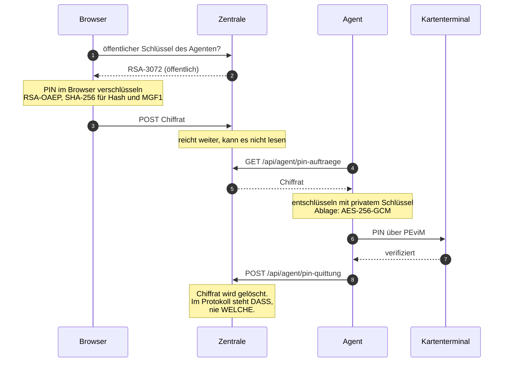

---

### 6.2c Wiederherstellung einer Sicherung

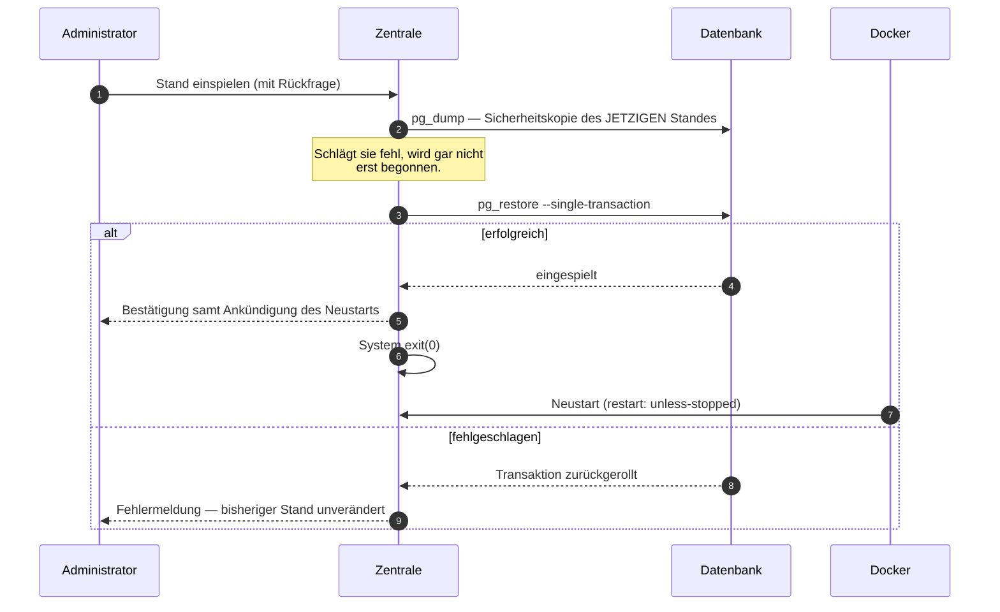

> **Warum der Neustart:** Die Zentrale hält Zustand im Arbeitsspeicher, der zum
> *alten* Datenstand gehört. Die Kernfunktion läuft im Agenten weiter und ist
> nicht betroffen.

---

### 6.3 Firmware-Rollout im Zeitfenster

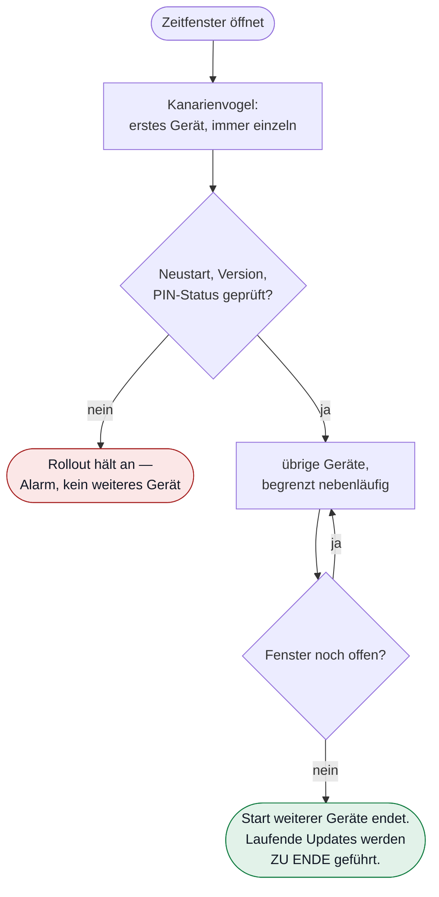

> **Ein begonnenes Geräteupdate wird immer zu Ende geführt.** Das Fenster
> begrenzt den *Start* weiterer Geräte — ein abgebrochenes Firmware-Update ist
> der einzige Weg, ein Terminal doch zu beschädigen.


Der Rollout ist ein **langlebiger Vorgang über mehrere Fenster**, kein einmaliger
Lauf. Sein Zustand ist persistent und übersteht einen Neustart (NFA-VER-020).

### 6.4 Ausfall der Zentrale


Begründung: Die Kernfunktion sichert den TI-Zugang und darf nicht von der
Zentrale abhängen. Ein Firmware-Rollout ist dagegen ein geplanter Eingriff — den
ohne Aufsicht zu beginnen wäre falsch.

---

## 7. Verteilungssicht

### Verteilter Betrieb — Einzelpraxis, MVZ

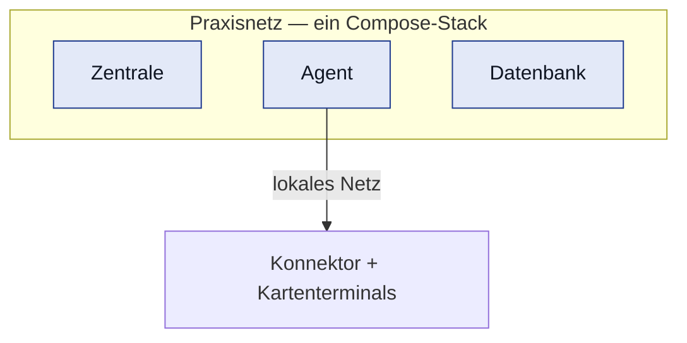

Ein Startbefehl, eine Adresse, eine Oberfläche. Die Ebene der
Serviceorganisationen bleibt im Datenmodell vorhanden, in der Oberfläche jedoch
ausgeblendet (FA-INS-030).

### Zentraler Betrieb — Serviceorganisation, Klinik

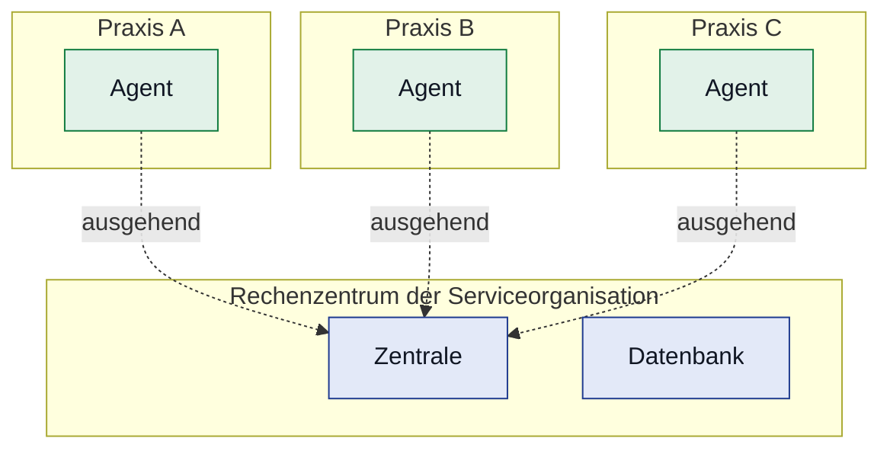

> **In keiner der drei Praxen ist eine eingehende Freigabe nötig.** Das ist der
> Grund für die Richtung des Verbindungsaufbaus.


Nur die Zentrale muss erreichbar sein; in den Kundennetzen ist **keine einzige
eingehende Freigabe** nötig. Die Last der Geräteabfragen bleibt verteilt — das
ist der Grund, warum 5.000 Terminals beherrschbar sind.

---

## 8. Querschnittskonzepte

### 8.1 Mandantentrennung

Jedes mandantenbezogene Objekt trägt die Einrichtungskennung. Die Einschränkung
auf den Geltungsbereich des Aufrufers wird an **einer zentralen Stelle** in der
Datenzugriffsschicht erzwungen — nicht in einzelnen Abfragen.

**Begründung:** Die häufigste schwere Lücke mandantenfähiger Anwendungen ist die
eine vergessene Filterbedingung. Hier ginge es um SMC-B-Daten fremder Praxen.
Eine Abfrage ohne Geltungsbereich muss deshalb **technisch unmöglich** sein, nicht
nur unüblich. Der Nachweis erfolgt für jeden Zugriffspunkt automatisiert
(FA-ORG-020) — einschließlich Protokoll und Export.

### 8.2 Umgang mit Geheimnissen

| Geheimnis | Liegt beim | Sichtbar für |
|---|---|---|
| SMC-B-PIN | Agent | niemanden nach dem Speichern |
| Terminal-Administrationszugang | Agent | niemanden nach dem Speichern |
| Konnektor-Zugang | Agent | niemanden nach dem Speichern |
| GHCR-Token | Zentrale | niemanden nach dem Speichern |
| Benutzerpasswort | Zentrale | niemandem (nur Prüfwert gespeichert) |
| TOTP-Geheimnis | Zentrale | einmalig bei der Einrichtung |

Regeln:
- Verschlüsselte Ablage; der Schlüssel liegt weder im Image noch im Repository.
- **Einbahnstraße:** Es existiert keine Schnittstelle, die ein Geheimnis
  zurückliefert. Auch nicht für Administratoren.
- Die Unterdrückung in Protokollen und Fehlermeldungen ist **zentral** umgesetzt.
  Eine neue Protokollstelle kann sie nicht umgehen — sonst wäre sie eine Frage
  der Sorgfalt, und Sorgfalt versagt irgendwann.

### 8.3 Nebenläufigkeit und Lastbegrenzung

- Geräteabfragen laufen **nebenläufig mit Obergrenze je Konnektor**. Ein langsamer
  Konnektor darf andere nicht ausbremsen (NFA-LEI-020).
- Die Warteschlange ist **fair**: Kein Gerät verhungert, weil andere ständig
  Fehler erzeugen.
- Prüfintervalle werden **zeitlich gestreut**, damit nicht alle 5.000 Geräte
  gleichzeitig abgefragt werden.
- Aufträge sind **idempotent**: Ein doppelt zugestellter Auftrag darf keine zweite
  Verifikation auslösen.

### 8.4 Fehlerbehandlung

| Fehlerart | Verhalten |
|---|---|
| Fremdsystem nicht erreichbar | Wiederholung mit wachsendem Abstand, Obergrenze, Alarm |
| Zeitüberschreitung | wie oben; laufende Vorgänge sauber beenden |
| **Fehlgeschlagene PIN-Verifikation** | **keine Wiederholung**, anhalten, alarmieren |
| Ungültige Konfiguration | beim Start abbrechen mit verständlicher Meldung |
| Unerwarteter Zustand am Gerät | anhalten und melden, nicht raten |

Jede Fehlermeldung existiert **zweifach**: technisch für das Diagnoseprotokoll,
verständlich für die Oberfläche (NFA-USA-020). Die Übersetzung ist eine
gepflegte Zuordnung, kein Zufallsprodukt — auch für Konnektor-Fehlercodes wie
`4078`.

### 8.5 Zeit

- Alle Zeitpunkte werden intern in **UTC** geführt, in der Oberfläche lokal
  dargestellt.
- Rollout-Zeitfenster werden in der **Zeitzone der Einrichtung** ausgewertet —
  eine Klinik in einer anderen Zeitzone als das Rechenzentrum ist im zentralen
  Betrieb ein realer Fall.
- Sommer-/Winterzeit: Ein Fenster, das durch die Umstellung ausfällt oder doppelt
  auftritt, ist definiert zu behandeln und zu testen (FA-FW-020).
- Ein Zeitversatz zwischen Agent und Zentrale wird erkannt und gemeldet — TOTP
  und Zeitfenster hängen daran.

### 8.6 Datenmodell — tragende Beziehungen

Stand nach [ADR-0012](adr/0012-geraetehierarchie-nach-organisationsstruktur.md)
(12.08.2026):

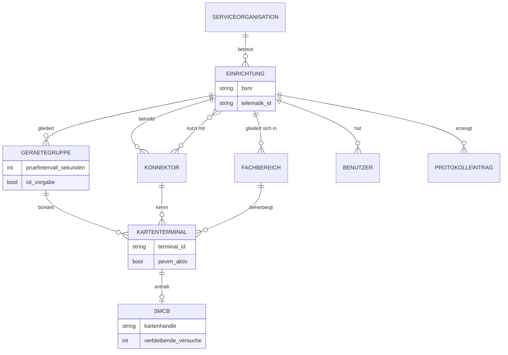

> **Jede Beziehung trägt die Mandantengrenze mit.** Eine Gerätegruppe liegt in
> genau einer Einrichtung — deshalb lässt sich der Geltungsbereich eines
> Benutzers in jeder Abfrage auf dieselbe Weise durchsetzen.
>
> Die eine Ausnahme ist der **Konnektor**: Seit „Konnektor as a Service" teilen
> sich mehrere Leistungserbringer einen. Er hat deshalb **einen Betreiber**
> (`konnektor.organisation_id`) und **beliebig viele Nutzer**
> (`konnektor_nutzung`). Sehen darf ihn, wer ihn nutzt; ändern nur, wer ihn
> betreibt. Beides wird zentral geprüft, nicht je Route.


Bewusste Festlegungen:
- **Die Betriebsstätte ist der Mandantenanker.** Sie ist zugleich die
  Leistungserbringerinstitution der TI: Sie trägt BSNR, Telematik-ID und die
  SMC-B. Träger, Standort und Fachbereich haben keine eigene Identität.
- **Der Fachbereich ist eine Ebene des Organisationsbaums, keine eigene
  Tabelle.** Ein Kartenterminal hängt an der untersten passenden Einheit; ob das
  eine Betriebsstätte oder ein Fachbereich ist, ergibt sich aus deren Art. Ein
  zweites Feld „Fachbereich" neben `organisation_id` könnte auseinanderlaufen.
- **Wer Geräte einer Betriebsstätte zählt, zählt den Teilbaum.** Mit
  Fachbereichen ist ein Vergleich auf die eine Kennung zu eng — der
  Geltungsbereich rechnet ohnehin rekursiv.
- **Gerätegruppen und Zeitfenster gehören in Version 1**, auch wenn der Rollout
  später kommt. Nachrüsten wäre ein Umbau des halben Modells.
- **Protokollereignisse liegen physisch getrennt** von den Betriebsdaten
  (eigenes Volume, FA-PRO-070) — unterschiedliches Wachstum, unterschiedliche
  Aufbewahrung, unterschiedliches Ausfallrisiko.
- **Ein Terminal kann später über verschiedene Wege erreichbar sein** (direkt
  oder über Tunnel, ADR-0003). Heute ist das ein Feld, später eine Funktion.

### 8.7 Protokollierung

Zwei getrennte Ströme (ADR-0005): das **Fachprotokoll** in der Datenbank, nur
anfügbar, mit Vorgangsnummer und fester Ereignisliste — und das **technische
Protokoll** als strukturierte Ausgabe. Die Vorgangsnummer verbindet beide, damit
der Support eine fachliche Meldung bis in die technischen Details verfolgen kann.

---

## 8.8 Einheitlichkeit der Oberfläche — erzwungen, nicht gepflegt

Am 09.08.2026 wurde die Oberfläche vermessen statt begutachtet: 142 von 154
Bedienelementen ohne Kurzhinweis, 0 von 97 Tabellenzeilen klickbar, 37
verschiedene Abstandswerte.

Die Ursache war **kein** Mangel an Sorgfalt an 142 Einzelstellen, sondern das
Fehlen eines gemeinsamen Bausteins: Jede Seite baute ihre Knöpfe und Tabellen
selbst, also wich jede ein wenig ab.

> Einheitlichkeit, die von Sorgfalt abhängt, zerfällt mit jeder neuen Seite.

Deshalb ist die Antwort architektonisch, nicht kosmetisch:

- **`Bedienelemente`** mit dem Kurzhinweis als **Pflichtparameter**. Ein Knopf
  ohne Erklärung lässt sich nicht bauen — das erledigt der Compiler.
- Ein **Abstandsraster** (`--r1` bis `--r6`) statt frei gewählter Werte.
- **20 maschinelle Prüfpunkte** (`pruefungen/oberflaeche-pruefen.sh`), die nicht
  fragen, ob Sortierung *angeboten* wird, sondern ob sie die Reihenfolge
  *ändert*.

Damit reiht sich die Oberfläche in dasselbe Muster wie `Geltungsbereich` (8.1)
und die Einrichtung in `pruefe()`: **Was nicht vergessen werden darf, wird nicht
der Sorgfalt überlassen, sondern dem Compiler oder einer zentralen Stelle.**

---

## 8.9 Wiedereinstieg nach Datenverlust

Der Zugang zur Zentrale hing an einem Konto, das einmalig bei der
Ersteinrichtung entstand — mit einem TOTP-Geheimnis, das genau einmal angezeigt
wurde. Ging das Datenvolumen verloren, entstand bei der nächsten Ersteinrichtung
ein **anderes** Geheimnis; der Eintrag in der Authenticator-App war tot, und
niemand kam mehr hinein.

Das ist im Projekt dreimal passiert. In einer Praxis ohne IT-Personal wäre es
ein Ausfall mit Anruf beim Hersteller.

`Startkonto` (FA-BEN-035) legt das Konto beim Start an, falls es fehlt, und
übernimmt ein vorgegebenes TOTP-Geheimnis. Ein **vorhandenes** Konto wird nie
verändert — sonst könnte jemand mit Schreibzugriff auf die Konfiguration sich
per Neustart immer wieder Zutritt verschaffen, auch nachdem man ihn ausgesperrt
hat.

**Der Tausch, den der Betreiber eingeht:** Wer die Konfiguration lesen kann,
kennt beide Faktoren — der zweite ist dann keiner mehr. Gegenmaßnahmen: Passwort
aus einem Docker-Secret statt aus der Umgebung, und Entfernen der Variablen nach
der Einrichtung. Beides steht in
[09-devops-installation.md](09-devops-installation.md).

---

## 9. Was diese Architektur bewusst nicht tut

| Nicht getan | Warum |
|---|---|
| Feingliedrige Aufteilung in viele Dienste | Der Betreiber hat kein IT-Personal. Zwei Bausteine sind das Minimum, das die Netzgrenze erzwingt — jeder weitere erhöht die Betriebslast ohne Gegenwert. |
| Nachrichtenbroker als eigene Komponente | Bei 5.000 Geräten und Sekunden-Intervallen nicht erforderlich; er würde eine dritte Instanz in jede Praxis bringen. |
| Eigene Kryptographie | Ausschließlich etablierte, geprüfte Verfahren und Bibliotheken. |
| Zwischenspeicher als eigene Instanz | Erst wenn eine Messung ihn rechtfertigt. |
| PIN in der Zentrale | Bewusste Entscheidung aus ADR-0002 — sie kostet Bequemlichkeit und spart im Schadensfall die PINs aller betreuten Praxen. |

---

## 10. Risiken

| Risiko | Wirkung | Gegenmaßnahme |
|---|---|---|
| PEviM-Kette verhält sich real anders als spezifiziert | Kernfunktion trägt nicht | **Technischer Durchstich am Testaufbau vor allem anderen** |
| Herstellerschnittstellen weichen stark voneinander ab | Aufwand je Hersteller unterschätzt | Kapselung (5.4); früh zwei Hersteller prüfen, nicht einen |
| Fehlerhafte Sicherungslogik sperrt eine Karte | schwerster denkbarer Schaden | Sonderweg im Code, verpflichtender Test vor jeder Auslieferung |
| Mandantentrennung an einer Stelle vergessen | fremde Praxisdaten sichtbar | zentrale Durchsetzung, Test je Zugriffspunkt |
| Leistungsziele bei 5.000 Geräten verfehlt | Produkt für Kliniken untauglich | Messreihe früh, nicht am Ende (NFA-LEI-040) |
| Drei Zielplattformen erzeugen Sonderfälle | Supportlast | von Beginn an auf allen drei bauen und testen |

---

## 11. Offene Punkte

1. **ADR-0006 Technologie-Stack** — steht aus.
2. **Datenhaltung im zentralen Betrieb** — eine Datenbank für alle Mandanten oder
   getrennte Schemata? Entscheidung nach Messung und Datenschutzbewertung.
3. **Agentenprotokoll** — konkrete Ausgestaltung; hängt an der Stack-Entscheidung.
4. **Referenzhardware** für die Leistungsmessungen.

---

## 8.10 Datensicherung

Seit dem 10.08.2026 sichert die Zentrale ihre Datenbank selbsttätig
([ADR-0010](adr/0010-datensicherung-und-wiederherstellung.md)). Drei Pläne mit
Rotation, ein eigenes Volume, verschlüsselter Download.

Drei Entscheidungen tragen das:

**`pg_dump` statt eigenem Format.** Bei einer Sicherung ist das Risiko
unsymmetrisch: Ein Format, das sich im Ernstfall nicht zurückspielen lässt, ist
schlimmer als gar keine Sicherung — es erzeugt Sicherheit, die nicht da ist.
Preis: 30 MB im Image und eine Versionskopplung zwischen Client und Server.

**Der Schlüssel wird nicht gespeichert.** Damit verlässt keine lesbare Kopie
des Datenbestands die Instanz — und ein verlorener Schlüssel macht die Datei
endgültig unbrauchbar. Das ist gewollt und wird dem Betreiber vorher gesagt.

**Nach der Wiederherstellung startet die Zentrale neu.** Sie hält Zustand im
Arbeitsspeicher, der zum alten Datenstand gehört; ein Neustart ist der einzige
Weg ohne Mischzustand. Die Kernfunktion läuft im Agenten weiter und ist nicht
betroffen — dieselbe Aufteilung, die schon
[ADR-0002](adr/0002-betriebsmodell-und-systemtopologie.md) begründet.

Damit reiht sich die Sicherung in dasselbe Muster wie 8.8 und 8.9: **Was der
Betreiber nicht regelmäßig tun kann, darf nicht von ihm abhängen.**
