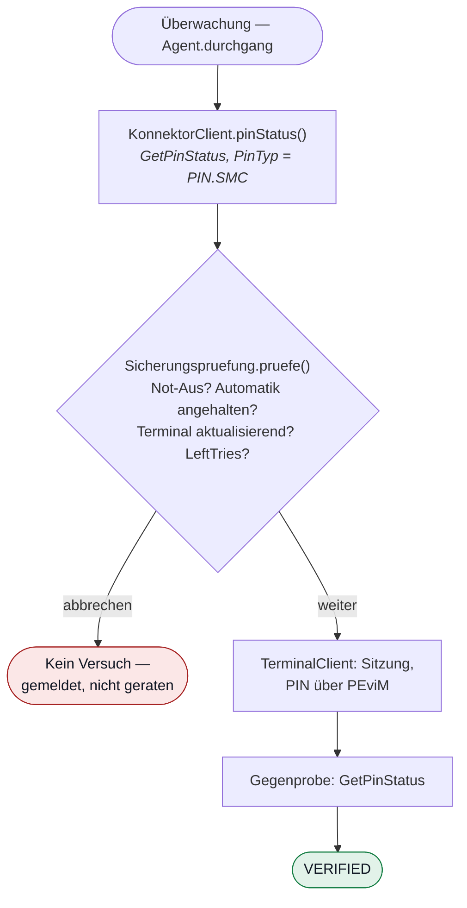

# Umsetzung: PIN-Verifikation

**Anforderungen:** FA-PIN-020 (automatische Verifikation), FA-PIN-030 (Schutz vor
Kartensperrung), FA-UEB-010 (Statusüberwachung), FA-UEB-050 (Zustand
„aktualisierend")

---

## Der Ablauf im Code

> Die Sicherungsprüfung steht **vor** dem Versuch, nicht danach. Ein Abbruch
> kostet nichts; ein Versuch zu viel kann die Karte sperren.

## Drei Entscheidungen, die nicht verhandelbar sind

### 1. Die Sitzung am Terminal besteht VOR dem VerifyPin

`[gemSpec_KT] A_24081` verlangt, dass die Rolle `SMC-B_Nutzer` bereits
authentisiert ist, **wenn das SICCT-Kommando eintrifft**. Trifft es ein, ohne
dass jemand angemeldet ist, erwartet das Terminal die Eingabe am PIN-Pad — und
dort steht nachts niemand.

Deshalb laufen Anmeldung und Verifikation im Code **nebenläufig**: Der
`VerifyPin`-Aufruf kehrt erst zurück, wenn die PIN geliefert wurde, also muss die
Lieferung parallel erfolgen. Das sieht im Quelltext umständlich aus und ist es
nicht — es ist die einzige Reihenfolge, die die Spezifikation zulässt.

### 2. Nach einem abgelehnten Versuch wird nicht wiederholt

Überall sonst im System gilt: Fehlschlag → Wiederholung mit wachsendem Abstand.
**Hier nicht.** Drei falsche Versuche sperren die SMC-B, und dann steht die
Praxis, bis jemand mit der PUK kommt.

`Sicherungspruefung` ist deshalb die wichtigste Klasse des Produkts. Sie prüft
`LeftTries` gegen den zuletzt gesehenen Wert: Ist er gesunken, hat *irgendetwas*
eine falsche PIN übergeben — wir selbst oder jemand am Gerät. In beiden Fällen
wird angehalten und alarmiert.

Zusätzlich gilt eine Untergrenze: Bei nur noch einem verbleibenden Versuch wird
nicht automatisch geraten, auch wenn der Zähler nicht gesunken ist.

**Sie sitzt im Agenten, nicht in der Zentrale.** Eine Schutzfunktion, die eine
Netzverbindung voraussetzt, ist keine.

### 3. Die abschließende Statusabfrage ist Pflicht

`PinResult = OK` ist die Antwort auf einen Aufruf. Erst ein erneutes
`GetPinStatus` mit `VERIFIED` belegt den Zustand. Der Unterschied klingt
pedantisch und ist es nicht: Im Test trat der Fall auf, dass das Terminal Erfolg
meldete und die Nachprüfung etwas anderes zeigte.

## Nachweis

`SicherungspruefungTest` prüft zehn Fälle. Der wichtigste — **falsche PIN löst
genau einen Versuch aus** — läuft zusätzlich im Systemnachweis gegen den
laufenden Stack: neun Gelegenheiten in 45 Sekunden, ein Versuch, `LeftTries`
sinkt um genau eins, Automatik hält an.

An echter Hardware verbrennt dieser Test bei jedem Durchlauf einen Fehlversuch;
nach drei Läufen wäre die Karte gesperrt. Das ist der Grund für den Simulator
(ADR-0007).

## Offen

- **Kalibrierung an echter Hardware.** Alles hier ist gegen den Simulator
  geprüft. Der bildet die Spezifikation ab, nicht notwendigerweise die
  Wirklichkeit.
- **FA-PIN-060 PIN ändern** (`A_24082`) — inzwischen umgesetzt, siehe [Umsetzung 23](23-pin-aendern.md)
