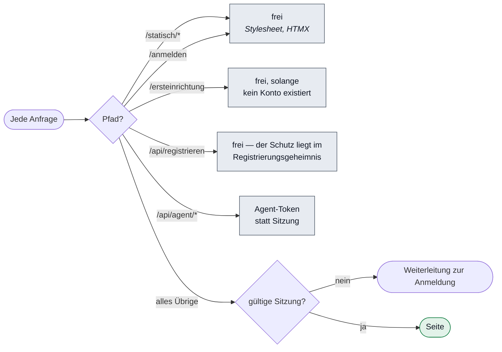

# Umsetzung: Anmeldung und Benutzerverwaltung

**Anforderungen:** FA-BEN-010/020/030, NFA-SIC-010, NFA-SIC-050

---

## Zugriffsschutz: Sperre mit Ausnahmeliste

Der Schutz sitzt an **einer** Stelle (`Zentrale.starten`, `app.before`) und ist
als Sperre gebaut, nicht als Freigabe je Seite:

**Warum diese Richtung:** Eine neue Seite ist damit von sich aus geschützt.
Andersherum wäre sie offen, bis jemand daran denkt — und irgendwann denkt
niemand daran. Dasselbe Prinzip wie bei der Mandantentrennung.

## TOTP selbst umgesetzt

Rund fünfzig Zeilen, und RFC 6238 liefert **offizielle Testvektoren**. Gegen
einen veröffentlichten Standard lässt sich die eigene Umsetzung beweisen; eine
Bibliothek wäre eine ungeprüfte Abhängigkeit mehr an sicherheitskritischer
Stelle.

Entscheidungen im Detail:

- **Vergleich in konstanter Zeit.** Ein `equals` verrät über die Laufzeit, wie
  viele Stellen stimmen — bei sechs Ziffern praktisch ausnutzbar.
- **Toleranz genau ein Zeitfenster.** Mehr wäre bequemer und verlängerte die
  Gültigkeit eines abgefangenen Codes ohne Not.
- **Ein verbrauchter Code gilt kein zweites Mal.** Das Fenster wird je Benutzer
  vermerkt. Ohne diese Regel nützte ein abgefangener Code bis zu 90 Sekunden.
- **Leerzeichen werden ignoriert.** Apps zeigen `123 456`; genau so tippen
  Nutzer ab. Daran darf keine Anmeldung scheitern.

## Passwörter: Argon2id

Parameter nach OWASP-Empfehlung (19 MiB, 2 Durchgänge). Das Format ist
selbstbeschreibend — die Kosten lassen sich später erhöhen, ohne bestehende
Anmeldungen zu brechen.

**Keine Zeichenklassen-Regeln, nur Länge (12 Zeichen).** Erzwungene
Sonderzeichen führen erfahrungsgemäß zu `Passwort1!` und zu Zetteln am Monitor;
das BSI empfiehlt seit 2020 Länge statt Komplexität.

## Was die Anmeldung nicht verrät

Unbekannter Benutzer und falsches Passwort ergeben **dieselbe Meldung**.
Unterschiedliche Meldungen verraten, welche Konten existieren. Ein eigener Test
prüft, dass die beiden Texte identisch sind.

## Der letzte Administrator ist geschützt

`istLetzterAdministrator()` verhindert, dass sich eine Praxis versehentlich
selbst aussperrt.

## Bekannte Einschränkung

Das Sitzungscookie trägt `HttpOnly` und `SameSite=Strict`, aber **kein
`Secure`** — im Prototyp läuft die Oberfläche unverschlüsselt auf localhost. In
der Auslieferung setzt der vorgelagerte Reverse-Proxy TLS, und das Kennzeichen
muss dann gesetzt werden. **Das ist noch offen.**
