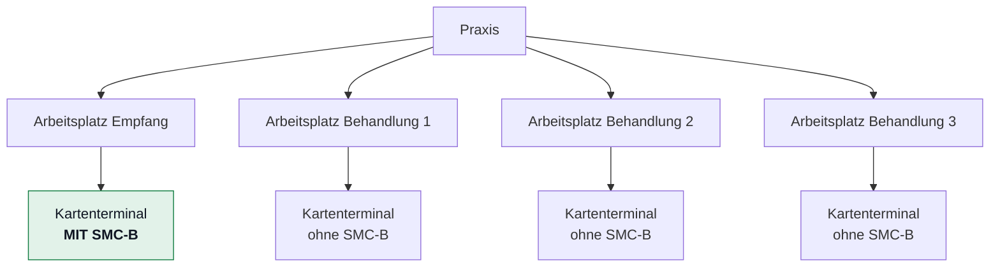

# Umsetzung: Bestandsverwaltung und Demodatensatz

**Anforderungen:** FA-GER-010 (Konnektoren erfassen), FA-GER-020 (Kartenterminals
erfassen), Teile von FA-GER-060 (Bedienbarkeit bei großen Stückzahlen)

**Entscheidung zur Geheimnisablage:** [ADR-0008](../adr/0008-ablage-von-geraete-zugangsdaten.md)

---

## Was hier entsteht

Bis zu dieser Iteration kamen alle Geräte aus dem Simulator oder aus dem
Demodatensatz. Jetzt lassen sich Konnektoren und Kartenterminals **von Hand
erfassen, ändern und löschen** — die Voraussetzung dafür, dass das Produkt an
einer echten Praxis eingerichtet werden kann.

| Baustein | Datei |
|---|---|
| Datenzugriff, Regeln, Erreichbarkeitsprüfung | `Bestandsverwaltung.java` |
| Oberfläche | `Bestandsseiten.java` |
| Verschlüsselte Ablage von Zugangsdaten | `gemeinsam/Geheimnisspeicher.java` |
| Schema | `Datenbank.java`, Migration 10 |

---

## Die vier Regeln, die den Aufbau bestimmen

### 1. Zugangsdaten gehen nur hinein, nie heraus

`FA-GER-010` verlangt: nach dem Speichern *„über die Oberfläche und über jede
Schnittstelle nicht mehr auslesbar"*.

Umgesetzt als **AES-256-GCM** mit Schlüssel aus `GEHEIMNIS_SCHLUESSEL`. Kein
Lesepfad gibt einen Klartext zurück — die Datensätze tragen nur ein
`passwortHinterlegt`-Kennzeichen. Es gibt genau zwei entschlüsselnde Methoden,
und sie heißen `konnektorPasswort` und `terminalAdminPasswort`, damit man sie
bei einer Durchsicht findet.

Warum Verschlüsselung und nicht ein Hash wie beim Anmeldekennwort: Der Wert muss
wieder verwendbar sein, um sich beim Gerät anzumelden. Ein Hash wäre hier
schlicht das falsche Werkzeug.

**Fehlt der Schlüssel**, bleibt die Erfassung vollständig nutzbar — nur ohne
Kennwörter, und die Oberfläche sagt das mit einem Hinweis. Ein Startabbruch
wäre die schlechtere Wahl: Er nähme dem Betreiber die Möglichkeit anzufangen.

Was das nicht leistet und warum trotzdem so entschieden wurde: ADR-0008.

### 2. Ein nicht erreichbares Gerät ist speicherbar

Bei der Ersteinrichtung steht der Konnektor oft noch gar nicht. Eine Erfassung,
die Erreichbarkeit erzwingt, treibt den Betreiber zu Fantasiewerten, die später
niemand mehr korrigiert.

Die Erreichbarkeit wird deshalb **geprüft und gemeldet**, nicht erzwungen:

```
Konnektor gespeichert. Unter 192.0.2.77:443 antwortet innerhalb von
3 Sekunden nichts. Das Gerät ist ausgeschaltet, nicht im Netz, oder
eine Firewall blockiert den Port.
```

Geprüft wird bewusst nur die **Transportebene** (TCP-Verbindung). Ein
vollständiger TLS-Aufbau mit Brainpool-Zertifikaten und Aufrufkontext gehört zum
Agenten. Für die häufigste Frage — *„habe ich mich in der Adresse vertippt?"* —
genügt die einfache Prüfung, und sie antwortet in Sekundenbruchteilen statt in
zehn Sekunden.

Die Meldungen unterscheiden vier Fälle, weil sie zu vier verschiedenen
Handlungen führen: Adresse unlesbar, Name nicht auflösbar, keine Antwort,
Verbindung abgelehnt.

### 3. Löschen darf nicht mehr mitnehmen als gemeint

Das Schema verknüpft Terminals per `ON DELETE CASCADE` mit ihrem Konnektor. Ein
Fehlgriff würde damit **lautlos einen halben Standort** aus der Überwachung
entfernen. Deshalb prüft die Anwendung vorher und verweigert mit Begründung:

```
Dem Konnektor „Praxis Nord“ sind noch 4 Kartenterminal(s) zugeordnet:
Empfang, Behandlung 1, Behandlung 2, Behandlung 3. Bitte diese Geräte
zuerst einem anderen Konnektor zuordnen oder löschen.
```

Die betroffenen Geräte werden **benannt**, nicht nur gezählt — sonst muss der
Administrator selbst suchen, was er übersehen hat.

### 4. PIN-Automatik nur mit SMC-B

`A_24080`: PEviM ist ausschließlich für SMC-B zulässig. Ein Terminal ohne SMC-B
mit aktiver Automatik wäre nicht nur wirkungslos — ein Versuch gegen die falsche
Karte könnte deren Fehlversuchszähler belasten. Die Kombination wird beim
Anlegen **und** beim Ändern abgelehnt, mit Nennung der Anforderungs-ID.

---

## Bedienbarkeit bei großen Stückzahlen

`FA-GER-060` verlangt Bedienbarkeit bei 5.000 Terminals. Die Grundlage:

- **serverseitige Paginierung** — 25 Treffer je Seite, `LIMIT`/`OFFSET` in der
  Abfrage, nicht im Browser
- **Volltextsuche** über Bezeichnung, Kennung und Standort
- **Filter** nach Konnektor
- **Index** auf `lower(bezeichnung)` und `lower(standortangabe)` — bei 5.000
  Geräten entscheidet er darüber, ob die Liste unter einer Sekunde steht
- **obere Grenze von 200** Datensätzen je Anfrage, damit eine manipulierte URL
  nicht den gesamten Bestand zieht

Sortierung, weitere Filter und Massenaktionen kamen im Nachtrag weiter unten
dazu. Offen bleibt allein die **Leistungsmessung** bei 5.000 Geräten.

Die Zählabfrage läuft getrennt von der Datenabfrage. Das ist eine Abfrage mehr,
aber die Alternative — alles laden und im Speicher zählen — ist genau das, was
bei 5.000 Geräten nicht mehr funktioniert.

---

## Demodatensatz: ein MVZ, wie es sie gibt

**Vorgabe PO, 11.08.2026:** ein realistisches MVZ-Szenario mit erfundenen
Praxisnamen.

Ein MVZ ist kein Verbund gleichförmiger Praxen. Es hat einen Träger, mehrere
**Betriebsstätten** an verschiedenen Standorten, gemischte Fachrichtungen und
sehr unterschiedliche Größen:

| Standort | Betriebsstätte | Fach | Terminals |
|---|---|---|---:|
| Nord | Hausarztpraxis Nordstadt | Allgemeinmedizin | 6 |
| Nord | Kardiologie am Nordring | Kardiologie | 4 |
| Nord | Orthopädie Nordpark | Orthopädie | 3 |
| Mitte | Hausärztliche Praxis am Markt | Allgemeinmedizin | 5 |
| Mitte | Innere Medizin Stadtmitte | Innere Medizin | 4 |
| Mitte | Radiologie Musterstadt | Radiologie | 2 |
| Süd | Hausarztpraxis Südhang | Allgemeinmedizin | 5 |
| Süd | Gynäkologie Südpark | Gynäkologie | 3 |
| Süd | Chirurgie und Unfallambulanz Süd | Chirurgie | 4 |

**Die unterschiedlichen Größen sind der Punkt.** Eine Oberfläche, die mit neun
gleichförmigen Vierergruppen gut aussieht, sagt nichts über eine Betriebsstätte
mit sechs Geräten und eine mit zwei. Dass die hausärztlichen Stätten die
größten sind, entspricht der Wirklichkeit.

Alle Namen sind erfunden; „Musterstadt" macht das an jeder Stelle sichtbar.

> **Fachlich entscheidend:** Die SMC-B ist die **Institutionskarte einer
> Betriebsstätte**, nicht die Karte eines Arztes. Jede Stätte hat deshalb genau
> eine, und sie steckt am Empfang.

### Eine Beschreibung, zwei Verwender

Das Szenario steht in `gemeinsam/Demoszenario.java`. Von dort lesen **beide**:
die Zentrale, um den Bestand anzulegen, und der Simulator, um dieselben Geräte
nachzubilden.

Zwei gepflegte Listen laufen irgendwann auseinander — und die Folge wäre
sichtbar gewesen: Der Agent hätte Geräte gemeldet, die zu keiner Betriebsstätte
gehören, und neben jedem Demogerät stünde ein zweites, unbekanntes. Dieselbe
Überlegung wie bei `SmcbProtokoll` (ADR-0011).

### Das Informationsmodell des Konnektors

Der Demodatensatz bildet auch die **Arbeitsplatzstruktur** nach, die der
Konnektor führt (`[gemSpec_Kon]`, Aufrufkontext `TUC_KON_000`):



> Für die PIN-Automatik ist damit **genau ein** Terminal je Praxis von Belang.
> Die übrigen werden überwacht, aber nie verifiziert — sie haben nichts
> freizuschalten.


Im gesamten MVZ: **36 Arbeitsplätze, 36 Terminals, davon 9 mit SMC-B** — eine
je Betriebsstätte. Alle Terminals haben die Managementschnittstelle
freigeschaltet (Vorgabe PO, 07.08.2026).

Warum die Arbeitsplätze im eigenen Datenmodell stehen und nicht nur im
Konnektor: Der Aufrufkontext entscheidet, **welches** Terminal der Konnektor
anspricht. Ohne die Zuordnung im eigenen Bestand könnte der Agent nicht
bestimmen, mit welcher Arbeitsplatz-Kennung er eine bestimmte SMC-B erreicht.

### Der Simulator bildet diese Geräte nach (Vorgabe PO, 11.08.2026)

Bis dahin war der Demodatensatz reine Bestandsverwaltung: 36 Geräte in der
Datenbank, aber kein einziges davon antwortete. Die Oberfläche zeigte 36 Zeilen
im Zustand „unbekannt" — man konnte die Mandantentrennung darin prüfen, aber
nicht sehen, was das Produkt eigentlich tut.

`Zustand.mitDemoteilnehmern()` bildet dieselben 36 Geräte im Simulator nach —
aus derselben Beschreibung, aus der die Zentrale ihren Bestand anlegt
(`Demoszenario`). Die Kennungen können damit gar nicht mehr auseinanderlaufen.

Damit gilt im Demoaufbau: alle Geräte erreichbar, Firmware 4.3.0,
Managementschnittstelle frei, neun SMC-B mit hinterlegter PIN. Die neun
Empfangsterminals werden binnen eines Prüfintervalls freigeschaltet und halten
danach je eine offene Verbindung zur Remote SMCB API.

**Der Demoaufbau ersetzt den Standardaufbau, er ergänzt ihn nicht.** Zwei Gründe:

1. Die Systemnachweise zählen gegen die vier Geräte des Standardaufbaus und
   gegen dessen Fehlerfälle. 36 weitere würden diese Zählungen verschieben.
2. Umgekehrt landen die vier Problemgeräte in der Einrichtung, für die der Agent
   registriert ist. Sie stünden dort ohne Bezug herum — in der Vorführung sah
   „Kardiologie Nord" dadurch acht Geräte, vier davon mit Fehlerbildern, die zu
   keiner Praxis gehörten.

Geschaltet wird über `DEMO_TERMINALS=an`. Das setzt `docker-compose.yml`; der
Prüfstand setzt es nicht und misst weiter gegen den Standardaufbau mit seinen
unangenehmen Fällen.

### Zugangsdaten und PIN-Kennzeichen (Vorgabe PO, 11.08.2026)

Zwei Dinge fehlten dem Demodatensatz, obwohl er 36 Geräte hatte:

**Die Zugangsdaten der Geräte.** Jedes Demo-Terminal hat jetzt einen
Administrationszugang, jeder Demo-Konnektor ein Kennwort — **verschlüsselt
abgelegt, auf demselben Weg wie ein echtes** (AES-256-GCM über den
Geheimnisspeicher, [ADR-0008](../adr/0008-ablage-von-geraete-zugangsdaten.md)).
Ein Demodatensatz, der sein Kennwort im Klartext ablegte, würde genau die
Stelle ungeprüft lassen, auf die es ankommt. Fehlt der `GEHEIMNIS_SCHLUESSEL`,
entstehen die Daten trotzdem — nur ohne Zugangsdaten. Wer den Demodatensatz
ausprobieren will, hat den Schlüssel oft noch nicht gesetzt.

**Das Kennzeichen „PIN hinterlegt".** Hier lag ein echter Fehler, nicht nur eine
Lücke im Demodatensatz:

> Die Zentrale leitete das Kennzeichen allein aus **ihren eigenen Aufträgen**
> ab. Eine PIN, die auf einem anderen Weg zum Agenten kam — aus seiner
> verschlüsselten Ablage nach einem Neustart, aus der Umgebung im Testaufbau —,
> war für sie unsichtbar. Die Oberfläche zeigte „keine PIN hinterlegt", während
> der Agent Karten freischaltete.

Der Agent meldet jetzt in jedem Bestandsbericht mit, **für welche Karten er eine
PIN hat** — nur die Kartenhandles, nie ein Wert und nie ein Chiffrat. Er ist an
dieser Stelle die Wahrheit: Er hat die PIN oder nicht.

Der gemeldete Bestand **ergänzt nur, er löscht nie**. Ein Eintrag, den der Agent
nicht mehr meldet, bleibt stehen — das ist die Warnung „PIN neu zu hinterlegen"
nach einem Agentwechsel (FA-INS-040). Würde hier gelöscht, verschwände die
Warnung zusammen mit dem Problem, das sie meldet. Gelöscht wird eine PIN
weiterhin ausschließlich über einen ausdrücklichen Auftrag.

> **Die PINs der neun Demokarten stehen als Umgebungsvariablen im
> `docker-compose.yml`.** Das ist der dokumentierte Testaufbau-Weg, und der
> Agent warnt beim Start ausdrücklich davor. Im Betrieb wird die PIN über die
> Oberfläche hinterlegt und Ende-zu-Ende verschlüsselt übertragen
> ([ADR-0009](../adr/0009-pin-hinterlegen-ueber-die-oberflaeche.md)); eine so
> hinterlegte PIN hat Vorrang. Beim Einsatz mit echter Hardware sind die neun
> Zeilen zu entfernen.

---

## Nachweise

**Modultests** (23 neue): `GeheimnisspeicherTest` (8), `BestandsverwaltungTest`
(15), `DemodatenTest` (8, aus derselben Iteration).

Bemerkenswert daran:

- **Nonce-Wiederverwendung** wird geprüft — sie würde AES-GCM vollständig
  brechen, und gleiche Chiffrate würden verraten, dass zwei Geräte dasselbe
  Kennwort haben.
- **Manipulation am Chiffrat** muss auffliegen und eine Meldung erzeugen, die
  sagt, was zu tun ist.
- **Kein Klartext in `toString()`** — sonst landet ein Kennwort irgendwann in
  einer Fehlermeldung oder einem Protokolleintrag.
- Die Erreichbarkeitsprüfung wird gegen `192.0.2.0/24` gemessen (nach RFC 5737
  für Dokumentation reserviert, nirgends geroutet) — ein verlässlicher
  Zeitüberschreitungsfall.

**Systemnachweise** (16 neue): Anlegen trotz Nichterreichbarkeit, Kennwort
verschlüsselt in der Datenbank, Kennwort auf keiner Oberflächenseite, A_24080
beim Anlegen abgelehnt, Löschschutz, doppelte Kennung, Protokollierung, kein
Kennwort im Fachprotokoll — dazu 13 Nachweise zum Demodatensatz.

---

## Ein Nachweis, der falsch gebaut war

Zwei Prüfungen (`Not-Aus ist protokolliert`, `abgelehnte Registrierungen werden
protokolliert`) flatterten: mal grün, mal rot, ohne Änderung am Produkt.

Beide prüften in **einem** Griff zwei verschiedene Dinge — ob ein Ereignis im
Protokoll *steht* und ob es in der *Ansicht* erscheint. Bei einem Fehlschlag war
nicht erkennbar, welches von beidem gescheitert war. Beide sind jetzt getrennt,
und im Fehlerfall geben sie eine Diagnose aus (Anzahl in der Datenbank, Anzahl
jüngerer Einträge, HTTP-Status).

Das reiht sich in eine Erfahrung ein, die dieses Projekt mehrfach gemacht hat:
**Etwa die Hälfte der Fehler saß in den Prüfungen, nicht im Produkt.** Ein
Nachweis, der nicht sagt, *was* er misst, ist kein Nachweis.

---

## Sortierung, Filter und Massenaktionen (nachgetragen 07.08.2026)

Damit ist FA-GER-060 vollständig, bis auf die Leistungsmessung bei 5.000 Geräten.

### Sortierung — eine Weißliste, kein Durchreichen

Das Sortierfeld kommt aus der URL und geht **unmittelbar** in die Abfrage ein;
als Parameter binden lässt es sich nicht. Ohne feste Liste wäre das eine
SQL-Einschleusung. Deshalb bildet eine Aufzählung `Sortierung` jeden Wert auf
einen festen Ausdruck ab — ein unbekannter Wert führt zur Vorgabe, nicht zu
einem Fehler und erst recht nicht in die Abfrage.

Jede Sortierung trägt **`t.id` als zweites Feld**. Ohne eindeutige Reihenfolge
wandern Zeilen zwischen den Seiten, sobald zwei Geräte denselben Wert haben —
bei „Firmware 4.2.1" ist das der Regelfall, nicht die Ausnahme.

Die Kopfzeile setzt `aria-sort`, damit Screenreader die aktuelle Sortierung
ansagen (WCAG 2.2 AA).

### Filter

Status, Erreichbarkeit, Modell, Firmware — die Auswahllisten für Modell und
Firmware werden aus dem Bestand erzeugt und bieten nur an, was vorkommt.

Ein Detail mit Wirkung: **Ein nie geprüftes Gerät ist nicht „nicht erreichbar",
sondern unbekannt.** Der Filter „nicht erreichbar" sammelt es deshalb nicht ein —
sonst suchte der Betreiber Fehler, wo keine sind.

### Massenaktionen

Aktivieren, Deaktivieren, Gruppe zuweisen. Zwei Regeln:

**1. Nichts läuft stillschweigend halb durch.** Das Ergebnis zählt geänderte und
übersprungene Geräte getrennt. „Aktion ausgeführt" bei 40 von 50 wäre eine
Falschmeldung — und bei 5.000 Geräten fällt so etwas niemandem auf, wenn man es
nicht ausdrücklich sagt.

**2. Eine Gruppe nimmt nur Geräte ihrer eigenen Einrichtung auf** (FA-GER-050).
Fremde werden übersprungen **und benannt**. Wäre das über eine Massenaktion
aushebelbar, stünde die Mandantentrennung offen.

Die Auswahl wird laufend mitgezählt und vor dem Ausführen bestätigt. Ohne diese
Rückmeldung klickt man auf „Deaktivieren" und weiß nicht, ob 3 oder 30 Geräte
gemeint sind.

### Ein Fehler, den die Tests gefunden haben

Die Hilfsmethode, die Filterwerte in die Abfrage setzt, machte aus allem außer
`Long` eine Zeichenkette. Ein `Boolean` wurde damit zu `"true"` und verglich sich
gegen eine `boolean`-Spalte **ins Leere**.

Der Filter lieferte lautlos null Treffer statt eines Fehlers. Solche Fehler sind
die unangenehmsten: Die Oberfläche sagt „keine Geräte", und niemand merkt, dass
die Frage falsch gestellt war. Gefunden hat ihn ein Test, der nach SMC-B
filterte und drei Treffer erwartete.

Zweiter Befund derselben Klasse: `List.toArray()` liefert `Object[]`, der
PostgreSQL-Treiber braucht `Long[]` — die Massenaktion scheiterte zur Laufzeit
und meldete „0 geändert".

---

## Nachtrag 11.08.2026: Was die Lage-Übersicht unbrauchbar machte

Beim Ausprobieren des Demoszenarios fiel zweierlei auf — der PO hat das erste
benannt, das zweite stand daneben im Bild.

### 1. Neun Geräte heißen „Behandlung 1"

In einem MVZ trägt jede Betriebsstätte dieselben Raumbezeichnungen. Die
Lage-Übersicht zeigte neunmal „Behandlung 1" mit der Kennung `KT-MALL-B1`
darunter — man sah, dass etwas ist, aber nicht **wo**.

Die Zeile trägt jetzt die Betriebsstätte:

```
Behandlung 1
Hausarztpraxis Nordstadt · KT-NHAU-B1
```

**Die Zuordnung kommt aus dem Bestand, nicht aus der Meldung des Agenten.** Das
ist der entscheidende Punkt: Ein Agent kennt genau **eine** Einrichtung — die
aus seiner Registrierung. In einem MVZ betreut er Geräte mehrerer
Betriebsstätten, und dann trügen in der Oberfläche alle denselben Namen.

Geladen wird die Zuordnung **einmal je Seitenaufbau** (`einrichtungJeTerminal`),
nicht je Zeile. Bei 5.000 Geräten wären das sonst 5.000 Abfragen für eine
Tabelle mit zwanzig Zeilen.

### 2. 27 Zeilen unter „Was zu tun ist", hinter denen nichts zu tun war

Die Tafel zeigte **alles außer OK** — damit landete jedes Behandlungsterminal
darin, mit der Meldung „Der Zustand konnte nicht ermittelt werden".

Diese Geräte haben gar keine SMC-B. Es gibt bei ihnen nichts freizuschalten,
und „unbekannt" ist keine Unsicherheit, sondern die richtige Antwort: Es gibt
nichts zu wissen.

| | vorher | jetzt |
|---|---|---|
| Tafel „Was zu tun ist" | alles außer OK (27 Zeilen) | nur WARNUNG und FEHLER (0 Zeilen) |
| Zustand ohne SMC-B | „unbekannt" | „keine SMC-B" |
| Erklärung | „Der Zustand konnte nicht ermittelt werden." | „In diesem Gerät steckt keine SMC-B. Es wird überwacht, aber es gibt nichts freizuschalten." |

**Eine Liste, in der fast alles steht, sagt nichts mehr.** Der Zweck der
Lage-Übersicht nach [ADR-0005](../adr/0005-protokollierung-und-nachvollziehbarkeit.md)
ist, dass jemand unter Zeitdruck in Sekunden erkennt, ob etwas zu tun ist. 27
Zeilen ohne Handlung machen genau das unmöglich.

### 3. Karteileichen beim Neuaufbau des Demodatensatzes

`pin_hinterlegt` blieb beim Löschen stehen. Die Einträge stammen nicht aus dem
Demodatensatz, sondern vom Agenten — er meldet, für welche Karten er eine PIN
hat. Nach zwei Neuaufbauten standen dort sechzehn Kennzeichen für neun
existierende Karten.

Das Löschen nimmt sie jetzt mit, und zwar **vor** den Terminals: Danach sind die
Kartenhandles nicht mehr auffindbar.

---

## Nachtrag 11.08.2026: Kartenterminals ohne Konnektor, Sortierung nach Einrichtung

Zwei Vorgaben des PO, die zusammengehören: Beide betreffen die Frage, **woran
ein Kartenterminal eigentlich hängt**.

### Der Konnektor war Pflicht — und das ging an der Praxis vorbei

Bis dahin galt: Erst der Konnektor, dann das Terminal, und die Einrichtung
ergab sich aus dem Konnektor. Das setzt eine Reihenfolge voraus, die es im
Alltag nicht gibt:

> Ein Gerät wird geliefert und aufgestellt, **bevor** es am Konnektor angemeldet
> ist. Wer es dann nicht erfassen kann, führt seinen Bestand nebenher auf
> Papier — und ab da stimmt der Bestand hier nicht mehr.

Deshalb ist jetzt die **Einrichtung das Pflichtfeld und der Konnektor die
Ergänzung**. Technisch stand die Einrichtung immer schon in der Zeile
(`organisation_id`), sie war nur fachlich abgeleitet.

| | vorher | jetzt |
|---|---|---|
| Pflichtangabe | Konnektor | **Einrichtung** |
| Einrichtung | aus dem Konnektor abgeleitet | eigene Angabe |
| Konnektor | Pflicht | optional, nachtragbar |

**Was ein Terminal ohne Konnektor nicht kann:** an der PIN-Automatik teilnehmen.
Das SICCT-Kommando sendet der Konnektor; ohne ihn gibt es keine Verifikation,
die zu beantworten wäre ([ADR-0011](../adr/0011-pin-uebergabe-ist-eine-anfrage-des-terminals.md)).

Das steht **oben auf der Geräteseite**, nicht in einer Fußnote — und direkt
darunter die Auswahl, um den Konnektor nachzutragen. Wer den Hinweis liest, will
ihn genau jetzt erledigen; ein Verweis auf eine andere Seite wäre eine Zumutung.

In der Liste steht „nicht zugeordnet" statt eines leeren Feldes. Leer wäre die
schlechteste Antwort: Man sähe nicht, ob die Angabe fehlt oder die Anzeige
klemmt.

**Die Einrichtung muss übereinstimmen.** Ein Terminal, das organisatorisch zu
Praxis A gehört und technisch an Konnektor B von Praxis C hängt, wäre in keiner
der beiden Sichten richtig einsortiert — die Zuordnung wird mit Begründung
abgelehnt.

> **Eine Falle, die dabei zuschnappen wollte:** Die Abfrage der Geräteliste
> verknüpfte mit `JOIN konnektor`. Ein Terminal ohne Konnektor wäre damit aus
> der Liste gefallen — ausgerechnet das Gerät, das noch Aufmerksamkeit braucht.
> Jetzt `LEFT JOIN`, und ein Test hält es fest.

### Standardsortierung: Einrichtung, dann Konnektor, dann Gerät

Vorher alphabetisch nach Gerätenamen. Das war die falsche Grundordnung: In einem
MVZ heißen die Geräte in jeder Betriebsstätte gleich, und neunmal „Behandlung 1"
untereinander ist keine Liste, sondern eine Aufzählung.

Nach Einrichtung sortiert steht zusammen, was zusammengehört — und man findet
ein Gerät dort, wo man es sucht: bei seiner Praxis. Der Konnektor ist das zweite
Kriterium, weil er innerhalb einer Einrichtung die technische Gliederung trägt.

Alle anderen Sortierungen bleiben über die Spaltenköpfe erreichbar.

### Nachweise

**Modultests** (6 neu in `BestandsverwaltungTest`, 1 angepasst in
`BestandslisteTest`):

| Test | Aussage |
|---|---|
| `ohneKonnektorErfassen` | geht, mit Einrichtung, und nennt das Hindernis |
| `ohneEinrichtungNicht` | die Mandantengrenze ist nicht verhandelbar |
| `fremderKonnektorAbgewiesen` | Terminal und Konnektor in derselben Einrichtung |
| `konnektorNachtragen` | hin und wieder zurück |
| `ohneKonnektorInDerListe` | `LEFT JOIN`, kein `JOIN` |
| `standardsortierung` | die Liste kommt nach Einrichtung sortiert |

> **Ein Testfehler, der wie ein Produktfehler aussah:** Zwei der neuen Tests
> scheiterten mit „Diesen Konnektor gibt es nicht mehr". Ursache war nicht der
> Code, sondern die Testreihenfolge — der Konnektor aus dem Aufbau wird von
> einem früheren Test gelöscht. Die neuen Tests legen sich jetzt einen eigenen
> an. Ein Test, dessen Ergebnis von der Reihenfolge abhängt, meldet früher oder
> später einen Fehler, den es nicht gibt.

---

## Nachtrag 11.08.2026: Die Gerätegruppen — drei Fehler und eine fehlende Seite

**Auslöser:** „In der Übersicht werden 9 Gruppen verauskunftet. In der
Gruppenliste stehen 19." Und, danach: „analysiere die Gruppenverwaltung von KT.
Das funktioniert nicht und hat keine usebility."

### Warum zwei Zahlen — beide richtig

Zehn Gruppen hatten **keine Organisationseinheit**. Die Übersicht zählt über
`organisation_id` und ließ sie weg; die Liste zeigte dem Instanzbetreiber alles.

Das ist mehr als ein Anzeigefehler. Eine Zeile ohne Mandantenzuordnung ist für
**jede** eingeschränkte Abfrage unsichtbar — `NULL = ANY(...)` ist niemals wahr.
Sie existiert nur für den, dessen Geltungsbereich keine Bedingung erzeugt.

`vorgabegruppeAnlegen()` suchte die Organisation über den Einrichtungsnamen und
legte die Gruppe auch dann an, wenn sich keine fand. **Migration 23** ordnet zu,
was sich zuordnen lässt, entfernt die leeren Reste und setzt `organisation_id`
auf `NOT NULL`. Gruppen mit Geräten werden nie gelöscht — dann scheitert die
Migration lieber und verlangt eine Entscheidung.

### Drei Fehler in der Verwaltung selbst

| Fehler | Wirkung |
|---|---|
| `loeschen(id, "Praxis")` | Die Einrichtung kam als fester Parameter. Ohne Gruppe in „Praxis" scheiterte **jedes** Löschen; mit einer wanderten Geräte **über die Mandantengrenze** in deren Vorgabegruppe. |
| kein Geltungsbereich | `intervallSetzen` und `loeschen` prüften nicht, wem die Gruppe gehört. Eine manipulierte Kennung genügte, um das Prüfintervall einer fremden Einrichtung zu verstellen — und damit deren Überwachung auszuhebeln. |
| Protokoll fest „Praxis" | Jede Gruppenänderung landete unter einer Einrichtung, die mit der Gruppe nichts zu tun hatte. |

Die Einrichtung ist beim Löschen **kein Parameter mehr**, sondern wird aus der
Gruppe gelesen: Was man nicht übergeben kann, kann man nicht falsch übergeben.

### Die Detailseite, die fehlte

Die Gruppenverwaltung war der einzige Bereich ohne Detailseite. Alles musste in
die Listenzeile passen — und was nicht hineinpasste, fehlte:

- **Umbenennen** gab es nicht. Ein Tippfehler kostete die Gruppe *und* ihre
  Gerätezuordnung, weil die Geräte beim Löschen in die Vorgabegruppe umziehen.
- **Vorgabe wechseln** gab es nicht.
- **Welche** Geräte in der Gruppe sind, sah man nicht — nur wie viele.
- Das Intervall speicherte **stumm**; man musste in der Tabelle nachsehen.

Ein Zwischenschritt war falsch: Erst machte ich den Namen zu einem Eingabefeld
*in der Liste*. Das brach den Nachweis „klickbare Zeilen" — zu Recht, denn ein
Klick ins Feld würde navigieren. Beides zusammen geht nicht, und eine Liste ist
der falsche Ort für etwas, das mehr als einen Wert hat.

**Beim Vorgabewechsel** läuft beides in einer Transaktion, alte Vorgabe zuerst:
Ein eindeutiger Index erlaubt nur eine je Einrichtung — in der anderen
Reihenfolge scheitert die zweite Anweisung, und die Einrichtung stünde ohne
Vorgabegruppe da. Dann fallen neu erkannte Geräte durch.

### Die Lage-Übersicht war im Mehrmandantenbetrieb blind

Gefunden beim Aufräumen, und der schwerste Befund des Tages:

```java
var offen = alarme.offene("Praxis", bereich(c));
```

Die wichtigste Seite des Produkts fragte Alarme **fest für eine Einrichtung**
ab. In einem MVZ mit neun Betriebsstätten hätte sie keinen einzigen Alarm
gezeigt — gesperrte Karte, totes Terminal, und die Lage meldet „nichts offen".

Der Geltungsbereich war längst da und ist die richtige Grenze. Die zusätzliche
Einschränkung war ein Rest aus der Zeit, als es nur eine Einrichtung gab.

> **Warum 379 Nachweise das gedeckt haben:** Die Prüfeinrichtung hieß „Praxis".
> Der Name war stiller Bestandteil der Abfrage — der Nachweis prüfte gegen genau
> den Wert, der im Code stand. Erst die Umbenennung der Prüfeinrichtung in
> „Pruefpraxis" machte es sichtbar. Der neue Nachweis prüft deshalb
> ausdrücklich, dass der angezeigte Alarm **nicht** zu „Praxis" gehört.

**Offen:** `grep '"Praxis"'` findet 54 weitere Stellen — Protokoll- und
Alarmaufrufe aus Hintergrundaufgaben (Sicherung, Pseudonymisierung,
Startkonto). Bei instanzweiten Ereignissen ist eine Einrichtung fachlich
fragwürdig; „Praxis" als Platzhalter ist es in einem MVZ allemal.
