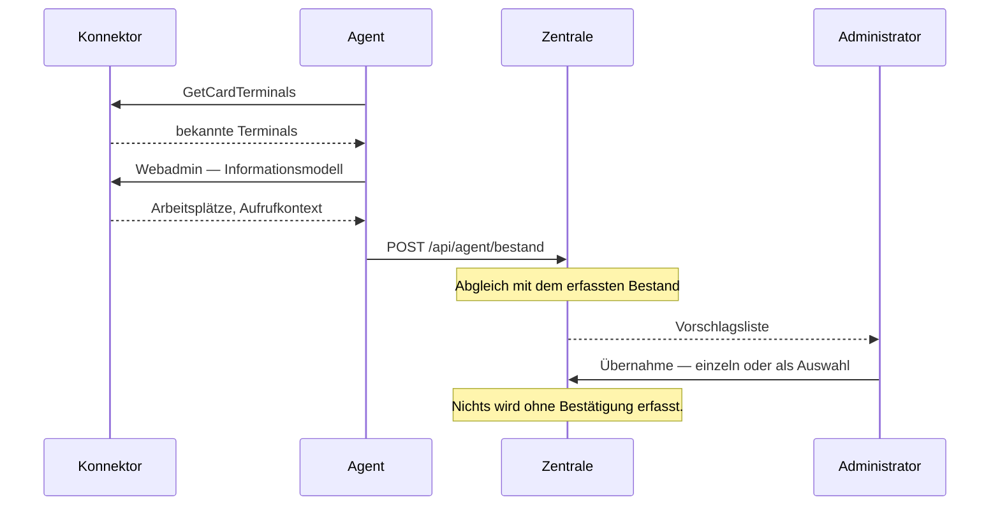

# Umsetzung: Bestandsermittlung über den Konnektor

**Anforderungen:** FA-GER-030 (Kartenterminals automatisch ermitteln),
FA-GER-035 (Informationsmodell des Konnektors auslesen), NFA-QS-035
(herstellerspezifische Funktionen sind optional)

---

## Warum der Agent ermittelt und nicht die Zentrale

Die naheliegende Umsetzung wäre: Die Zentrale ruft `GetCardTerminals` beim
Konnektor auf. Das geht nicht.

Der Konnektor steht im Praxisnetz. Nach [ADR-0002](../adr/0002-betriebsmodell-und-systemtopologie.md)
baut ausschließlich der **Agent ausgehend** auf — damit im Kundennetz keine
eingehenden Firewall-Freigaben nötig sind. Im zentralen Betriebsmodell (eine
Instanz für viele Einrichtungen) könnte die Zentrale den Konnektor gar nicht
erreichen.

Also: **Der Agent ermittelt und meldet, die Zentrale gleicht ab.**

**Gemeldet wird nur, was sich geändert hat.** Der Agent bildet einen Abdruck
über Terminalliste und Informationsmodell; bleibt er gleich, unterbleibt die
Meldung. Bei 5.000 Terminals im Minutentakt wäre eine vollständige Meldung je
Zyklus rund 7 Millionen Datensätze am Tag — dieselbe Überlegung wie bei der
Protokoll-Grundregel aus CLAUDE.md.

---

## Die Regel, an der alles hängt

> *„Die Übernahme erfolgt erst nach ausdrücklicher Bestätigung, einzeln oder als
> Auswahl — nie automatisch."* (FA-GER-030)
>
> *„Ein erneutes Auslesen erkennt Abweichungen zwischen Konnektor-Konfiguration
> und erfasstem Bestand und zeigt sie an, ohne selbsttätig zu ändern."* (FA-GER-035)

Der Grund ist nicht Vorsicht um ihrer selbst willen. Ein falsch konfigurierter
oder frisch zurückgesetzter Konnektor würde sonst einen gepflegten Bestand
überschreiben — mit **Zugangsdaten, Gruppenzuordnungen und Standortangaben, die
niemand wiederherstellen kann**. Der Konnektor kennt diese Angaben nicht; er
könnte sie nur löschen.

Deshalb liegt der Befund in **eigenen Tabellen** (`ermittelt_terminal`,
`ermitteltes_modell`), streng getrennt vom Bestand. Die Oberfläche zeigt den
Abgleich in vier Lagen:

| Lage | Bedeutung | Angebotene Aktion |
|---|---|---|
| **neu erkannt** | Konnektor kennt es, Bestand nicht | Übernehmen (mit Konnektorauswahl und Adresse) |
| **erfasst** | deckungsgleich | Im Bestand ansehen |
| **weicht ab** | erfasst, aber Angaben unterscheiden sich | nur Anzeige der Unterschiede |
| **nicht mehr gemeldet** | im Bestand, Konnektor kennt es nicht mehr | nur Anzeige mit Prüfhinweis |

Ein „nicht mehr gemeldetes" Gerät wird **nicht gelöscht**. Es kann vorübergehend
abgemeldet sein; ein automatisches Entfernen würde Zugangsdaten und Zuordnungen
vernichten.

Verglichen wird nur, was der Konnektor tatsächlich liefert — Modell, SMC-B,
PEviM-Zustand. Standort, Gruppe und Zugangsdaten kennt er nicht; eine
„Abweichung" dort wäre keine. Ein im Bestand leeres Feld gilt als Lücke, nicht
als Konflikt: Sie wird beim Übernehmen gefüllt.

---

## A_24080 auch hier

Der Konnektor kann ein Terminal als „PEviM aktiv" melden, obwohl keine SMC-B
steckt. Beim Übernehmen wird das korrigiert: Die PIN-Automatik landet nur dann
aktiv im Bestand, wenn auch eine SMC-B gemeldet ist.

**Die Regel setzen wir durch, nicht der Konnektor.** Ein Versuch gegen die
falsche Karte könnte deren Fehlversuchszähler belasten.

---

## Das Informationsmodell (FA-GER-035)

Jeder Aufruf der Fachschnittstelle braucht einen Aufrufkontext aus
**Mandanten-ID, Clientsystem-ID und Arbeitsplatz-ID** (`TUC_KON_000`). Abgetippt
sind diese Werte die häufigste und am schwersten zu diagnostizierende
Fehlerquelle bei der Inbetriebnahme: Ein Tippfehler äußert sich als
Zugriffsfehler ohne erkennbaren Zusammenhang.

Der Agent liest das Modell über die **Webadmin-Schnittstelle** und meldet es mit;
die Oberfläche zeigt es, damit die Werte übernommen statt geraten werden.

> **Diese Schnittstelle ist herstellerspezifisch und von der gematik nicht
> spezifiziert.** Sie ist deshalb **immer optional** (NFA-QS-035). Fällt sie aus:
>
> - Der Agent meldet ausdrücklich `informationsmodellVerfuegbar: false` — der
>   Unterschied zwischen „nie gelesen" und „gelesen, nicht verfügbar" steht in
>   den Daten und ist damit anzeigbar.
> - Die Oberfläche weist auf die **entfallende Unterstützung** hin, statt eine
>   Lücke zu zeigen, die wie ein Fehler aussieht.
> - Alles bleibt von Hand erfassbar. Nichts hält an.

Der Simulator bildet ein KoCo-artiges Modell nach. Nach
[ADR-0007](../adr/0007-simulierte-endpunkte-und-teststrategie.md) Regel 1 ist das
eine **Annahme** und gehört auf die Prüfliste für den ersten Hardwarekontakt.

Absichtlich bildet der Simulator dabei keine saubere Welt ab: Ein Arbeitsplatz
führt zwei Terminals, einer gar keins. Ein Simulator, der nur den Erfolgsfall
kennt, erzeugt trügerische Sicherheit.

---

## Nachweise

**Modultests** (11 in `ErmittlungTest`). Der wichtigste heißt
`nichtsWirdSelbsttaetigGeaendert` — er prüft, dass eine erkannte Abweichung den
Bestand nicht anfasst. Daneben: Aufnahme ist idempotent (eine zweite Meldung
erzeugt keine Dubletten), doppelte Übernahme wird abgewiesen, PEviM ohne SMC-B
wird beim Übernehmen entschärft, ein verschwundenes Gerät bleibt im Bestand.

**Systemnachweise** (12), gegen den vollständigen Stack mit laufendem Agenten:
Meldung kommt an, Informationsmodell wird gelesen, Aufrufkontext steht in der
Oberfläche, nichts wird selbsttätig übernommen, Übernahme nach Bestätigung
funktioniert samt Modell und Firmware, zweite Übernahme wird abgewiesen,
Abweichung wird erkannt **und benannt**, Bestand bleibt dabei unverändert,
beides ist protokolliert.

Die Abweichung wird dabei echt erzeugt: Über die Steuerschnittstelle des
Simulators wird PEviM am Gerät abgeschaltet, dann wird geprüft, ob die
Oberfläche das meldet und der Bestand trotzdem unverändert bleibt.

---

## Ein Fehler, den erst der Vollauf gezeigt hat

Der erste vollständige Nachweislauf meldete **12 ermittelte Terminals**, obwohl
der Simulator nur vier hat.

Ursache: Das Prüfskript startet den Stack mehrfach, und jeder Lauf registriert
einen neuen Agenten. Da die Funde je Agent gespeichert werden, standen dieselben
vier Geräte dreifach in der Liste — und die Übernahme griff ins Leere, weil die
Kennung nicht mehr eindeutig auflösbar war.

**Das ist kein Testartefakt.** Im Betrieb passiert dasselbe, sobald ein Agent
neu installiert wird: Die alten Funde bleiben stehen, die Liste zeigt Dubletten,
und Geräte erscheinen als „nicht mehr gemeldet", die längst ein anderer Agent
betreut.

Zwei Korrekturen:

- Der Abgleich zeigt je Terminal-Kennung nur den **jüngsten** Fund
  (`DISTINCT ON ... ORDER BY gesehen DESC`). Melden zwei Agenten dasselbe Gerät,
  zählt der letzte Stand.
- Berücksichtigt werden nur **aktive** Agenten. Ein widerrufener Agent
  hinterlässt keine Karteileichen mehr.

Dazu kam ein zweiter Befund: Die Modellanzeige nahm den *ersten* Agenten aus der
Liste — willkürlich. Nach einem Agentenaustausch zeigte sie das Modell eines
längst abgemeldeten Agenten oder gar keins. Jetzt gilt das **zuletzt gemeldete**
Modell eines aktiven Agenten.

Beide Fälle haben eigene Modultests bekommen
(`zweiterAgentErzeugtKeineDubletten`, `abgemeldeterAgentVerschwindet`), damit sie
nicht wiederkommen.

## Was noch fehlt

- **Mehrere Agenten**: Die Modellanzeige nimmt derzeit den ersten Agenten. Bei
  mehreren Standorten muss die Seite je Agent gruppieren — das gehört zum Umbau
  auf Mandantentrennung (Block A).
- **Mehrfachauswahl bei der Übernahme**: FA-GER-030 erlaubt „einzeln oder als
  Auswahl". Umgesetzt ist bisher nur einzeln.
- **Übernahme der Aufrufkontext-Werte per Klick** in die Konnektormaske. Das
  Modell wird angezeigt, aber noch nicht als Auswahlliste in das Formular
  verdrahtet.
