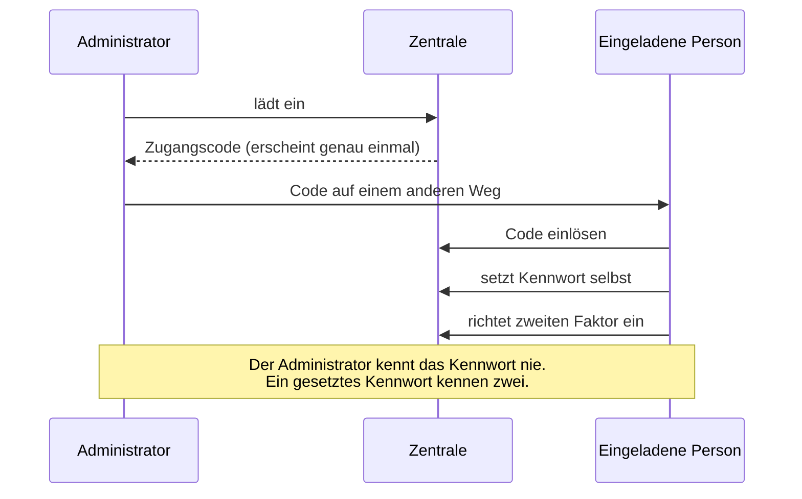

# Umsetzung: Benutzerverwaltung und Einladungen

**Anforderungen:** FA-BEN-010 (Konten verwalten), FA-BEN-030 (zweiter Faktor),
FA-BEN-040 (Konten deaktivieren), Block B

---

## Die eine Entscheidung, die alles andere bestimmt

**Ein Administrator legt kein Kennwort fest — er lädt ein.**

Warum: Ein Administrator, der ein Kennwort setzt, **kennt es**. Damit ist jede
spätere Handlung dieses Kontos nicht mehr eindeutig zurechenbar. Für ein System,
das selbsttätig handelt und dessen Auslösung nachvollziehbar sein muss
(ADR-0005), ist das ein Widerspruch im Fundament.

Der Ablauf stattdessen:

## Der Zugangscode

- **32 Byte Zufall**, Base64-URL-kodiert
- Gespeichert wird nur der **SHA-256-Hash**. Wer die Datenbank liest, kann keine
  Einladung einlösen.
- **Einmalig und befristet** (7 Tage). Ein Geheimnis, das beliebig oft und
  unbegrenzt gilt, ist ein Dauerzugang.
- **Nicht im Protokoll.** Protokolliert wird, *dass* eingeladen wurde und von
  wem — nicht der Code. Er wäre sonst für jeden lesbar, der das Protokoll
  einsehen darf.

Die Oberfläche sagt unmissverständlich, dass er genau einmal erscheint. Ohne
diesen Hinweis klickt jemand weiter, und die Einladung ist verloren.

### Ein schwaches Kennwort verbraucht die Einladung nicht

Sonst wäre sie durch einen Tippfehler unbrauchbar, und der Eingeladene müsste
beim Administrator um eine neue bitten. Die Reihenfolge ist deshalb: erst
Kennwort prüfen, dann verbrauchen, dann Konto anlegen.

**Aber:** Bei einem *gültigen* Kennwort wird zuerst verbraucht und dann angelegt.
Sonst ließe sich ein Geheimnis durch absichtliche Fehlversuche beliebig oft
prüfen.

---

## Zweiter Faktor zurücksetzen

Der häufigste Supportfall überhaupt: Das Telefon ist weg, und damit der Zugang.

Ohne diesen Weg müsste ein Konto neu angelegt werden — und seine Historie im
Protokoll wäre von der Person getrennt.

**Der Administrator sieht das neue Geheimnis nicht.** Er löst nur das
Zurücksetzen aus; das neue Geheimnis erscheint erst der betroffenen Person bei
ihrer nächsten Anmeldung. Sonst könnte er sich dauerhaft als sie ausgeben.

Das Zurücksetzen ist protokolliert — mit Namen des Administrators und der
betroffenen Person.

---

## Deaktivieren statt Löschen

Ein gelöschtes Konto reißt seine Spur im Protokoll mit: Der Anzeigename bliebe
stehen, aber niemand könnte ihn mehr zuordnen. Ein deaktiviertes Konto kann sich
nicht anmelden und bleibt trotzdem nachvollziehbar.

**Der letzte handlungsfähige Administrator lässt sich nicht deaktivieren.** Sonst
sperrt sich eine Praxis versehentlich selbst aus — und in einer Einrichtung ohne
IT-Personal ist das ein Fall für einen Dienstleister.

---

## Mandantengrenze und Rechte

Beides gilt auch hier:

- **Geltungsbereich:** Ein Praxisadministrator sieht nur die Konten seiner
  Praxis, kann nur dorthin einladen und nur dort zurücksetzen.
- **Einladung in eine fremde Einrichtung** wird abgelehnt. Die Einrichtung kommt
  aus einem Formularfeld; ohne Prüfung könnte sich jemand selbst Zugang zur
  Nachbarpraxis schaffen.
- **Rechte:** `darfBenutzerVerwalten()` — jeder Administrator in seinem Bereich.
  Sonst hinge jede Personalie an einer zentralen Stelle, und bei 1.000 Benutzern
  trägt das nicht.

## Bedienbarkeit bei 1.000 Konten

Suche über Benutzername und Name, Filter nach Rolle und Status (auch „zweiter
Faktor fehlt" — das ist die Arbeitsliste nach einer Einladungswelle), Blättern
mit 25 Konten je Seite.

> **Bewusste Abweichung:** Filterung und Blättern laufen hier **im Speicher**,
> nicht in der Abfrage. Bei 1.000 Konten ist das vertretbar, und die Alternative
> wäre eine weitere Abfrage mit Mandantengrenze gewesen — eine Stelle mehr, an
> der sie fehlen könnte. Sollte die Zahl deutlich wachsen, gehört das in die
> Datenbank; bei der Geräteliste mit 5.000 Einträgen wurde genau deshalb anders
> entschieden.

---

## Nachweise

**`EinladungenTest`, 11 Tests:** nur der Hash in der Datenbank, Einlösen legt das
Konto in der richtigen Einrichtung an, zweites Einlösen abgewiesen, erfundenes
Geheimnis verrät nichts, schwaches Kennwort verbraucht nicht, abgelaufene
Einladung abgewiesen, keine Einladung in fremde Einrichtungen, Geltungsbereich
bei Liste und Zurückziehen.

**Systemnachweise** über HTTP: Der ganze Ablauf vom Erzeugen bis zum
Zurücksetzen, dazu die Prüfung, dass der Code weder im Protokoll noch im
Klartext in der Datenbank steht.
