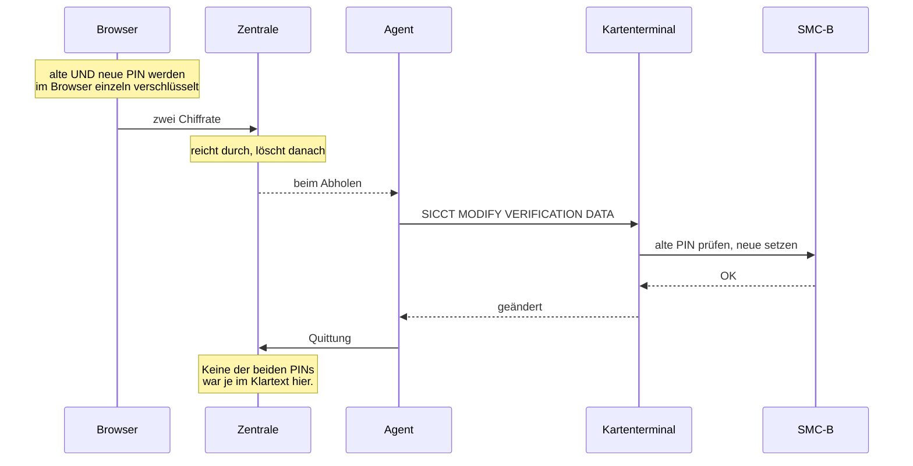

# 23 — PIN ändern (FA-PIN-060, A_24082)

**Stand:** umgesetzt und nachgewiesen (08.08.2026)

---

## Der Anlass

`FA-PIN-060` stand im Umsetzungsstand als „PIN löschen ✔". Im Katalog heißt die
Anforderung **PIN ändern** — über `SICCT MODIFY VERIFICATION DATA`. Gebaut und
nachgewiesen war das Löschen; das Ändern gab es nicht. Ein Haken, hinter dem
nichts stand.

## Der Weg — beide Werte verschlüsselt

Eine Änderung braucht **zwei** Werte: die alte PIN als Nachweis und die neue.
Beide werden im Browser verschlüsselt; die Zentrale kann keinen von beiden
lesen (ADR-0009).

**Die Wiederholung wird im Browser geprüft, nicht auf dem Server.** Sie *muss*
dort geprüft werden: RSA-OAEP ist nicht deterministisch, zwei Chiffrate
desselben Klartexts sehen völlig verschieden aus. Ein Serververgleich wäre
unmöglich.

## Der Punkt, an dem man Karten kaputt macht

**Auch das Ändern kann die Karte sperren.** Stimmt die alte PIN nicht, zählt
der Fehlversuchszähler herunter — genauso wie beim Verifizieren. Drei
Fehlversuche, und die Karte lässt sich nur noch mit der PUK entsperren.

Deshalb läuft vor jeder Änderung dieselbe Prüfung wie vor jeder Verifikation
(FA-PIN-030): Ist nur noch **ein** Versuch übrig, bricht der Roboter ab, statt
es zu wagen — und sagt, dass die PIN dann am Terminal selbst zu ändern ist.

Der Simulator bildet das nach: `SimulierteKarte.pinAendern` verbraucht bei
falscher alter PIN einen Versuch und sperrt nach dreien. Sechs Modultests
halten das fest, darunter „drei falsche Änderungsversuche sperren die Karte".

## Bei Fehlschlag bleibt alles, wie es war

Die neue PIN wird **erst dann** hinterlegt, wenn die Karte die Änderung
bestätigt hat. Andernfalls hätte der Agent eine PIN im Speicher, die auf der
Karte nicht gilt — und würde bei jedem Prüfdurchgang einen Fehlversuch
erzeugen. Nach drei Durchgängen wäre die Karte gesperrt, ohne dass jemand
etwas falsch gemacht hätte.

Nachgewiesen ist beides: dass eine falsche alte PIN abgelehnt und gemeldet
wird, **und** dass danach weiter die zuletzt gültige PIN gilt.

## Nachgewiesen

| | |
|---|---|
| Die Maske erfasst alte und neue PIN mit Bestätigung | 3 von 3 Feldern |
| Sie nennt die Grundlage | `A_24082` |
| Die Änderung wird ausgeführt und quittiert | ✔ |
| **Die Karte lässt sich mit der neuen PIN freischalten** | ✔ |
| Die neue PIN erscheint nirgends im Klartext | 0 Treffer |
| Auch das zweite Chiffrat wird nach Zustellung gelöscht | 0 verblieben |
| Eine falsche alte PIN wird abgelehnt und gemeldet | ✔ |
| **Danach gilt weiter die zuletzt gültige PIN** | ✔ |
| Unverschlüsselte Übergabe wird abgewiesen | ✔ |

Dazu 6 Modultests auf der Karte. **270 Systemnachweise** insgesamt, alle grün.

## Eine Anmerkung zur Priorität

Der Katalog führt FA-PIN-060 als **`SOLL · V2`** — also nicht als Pflicht für
Version 1. Umgesetzt wurde es trotzdem zuerst, weil dort ein falscher Haken
stand und der Aufwand überschaubar war. Die beiden noch offenen Sichten
(`FA-PRO-050`, `FA-PRO-060`) sind dagegen **`MUSS · V1`**.
