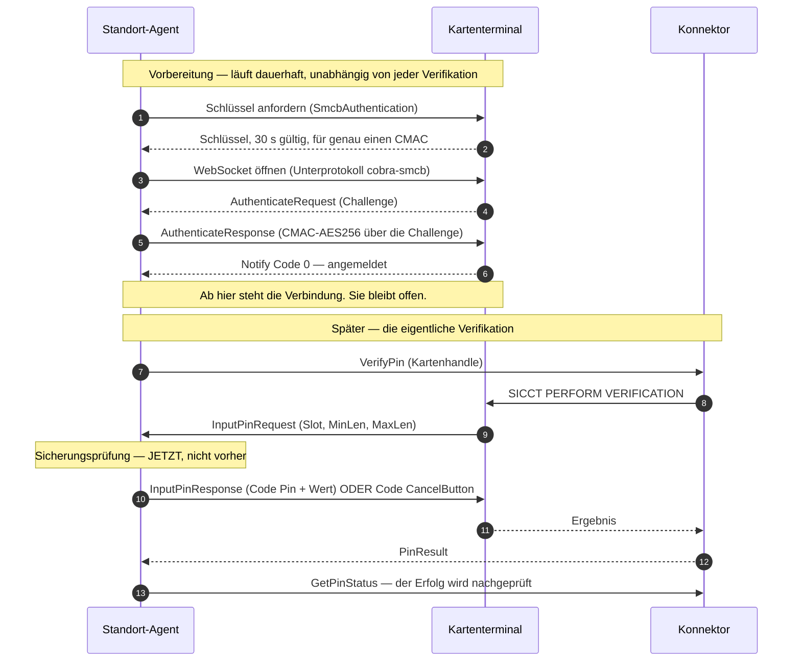

# 29 — Die Remote SMCB API: Das Terminal fragt, der Agent antwortet

**Stand:** 10.08.2026 · **Betrifft:** FA-PIN-020, FA-PIN-030, FA-UEB-050
· **Grundlage:** [ADR-0011](../adr/0011-pin-uebergabe-ist-eine-anfrage-des-terminals.md)

---

## Worum es geht

Der PIN-Roboter übergibt die SMC-B-PIN nicht mehr an das Kartenterminal. Er
**beantwortet eine Frage**, die das Terminal stellt.

Das klingt nach einer Feinheit und ist ein anderer Bauplan. Wer eine PIN
hinschiebt, braucht einen Moment, in dem er handelt. Wer eine Frage beantwortet,
muss **erreichbar sein, bevor die Frage kommt** — und zwar dauerhaft.

> Der ausführliche Hintergrund, samt der Fundstellen in der
> Herstellerspezifikation, steht in ADR-0011. Diese Beschreibung erklärt, wie es
> gebaut ist.

---

## Der Ablauf in fünf Schritten

**Der Bruch liegt zwischen Schritt 6 und 8.** Vorher war Schritt 8 ein Befehl
des Agenten. Jetzt ist er eine Antwort.

---

## Wer was macht

| Baustein | Aufgabe |
|---|---|
| `SmcbProtokoll` (gemeinsam) | Nachrichtenaufbau, CMAC-AES256, Regeln aus Abschnitt 7.7.8 |
| `SmcbVerbindung` (Agent) | **eine** Verbindung, ihr Zustand, das Beantworten der Anfragen |
| `SmcbVerbindungen` (Agent) | alle Verbindungen: aufbauen, abbauen, nachfassen |
| `Verifikationsablauf` (Agent) | den Konnektor anstoßen und das Ergebnis prüfen |
| `SmcbApiNachbildung` (Simulator) | die Gegenstelle, für Nachweise |

Der Protokollkern liegt **gemeinsam**, nicht im Agenten. Damit rechnen beide
Seiten des Nachweises mit demselben Code. Das ist die Lehre aus dem
RSA-OAEP-Fehler: Ein Test, in dem beide Seiten dieselbe eigene Auslegung
verwenden, prüft die Übereinkunft mit sich selbst. Deshalb hängt der CMAC-Test
an einem **fremden** Vektor aus NIST SP 800-38B.

---

## Die drei Entscheidungen, die Erklärung brauchen

### 1. Eine Verbindung nur, wo sie gebraucht wird

Die Spezifikation lässt **genau eine** Verbindung je Gerät zu. Eine, die nutzlos
offensteht, sperrt den Platz für jeden anderen.

Deshalb wird eine Verbindung nur gehalten, wenn **alle vier** Bedingungen
gelten: Gerät erreichbar, PEviM aktiv, SMC-B eingelegt, PIN hinterlegt. Fällt
eine davon weg, wird getrennt.

Nach einem gescheiterten Aufbau wird **zwei Minuten** nicht nachgefasst. Der
häufigste Grund für einen Fehlschlag ist ein Gerät, das die Schnittstelle nicht
anbietet — das ändert sich nicht in Sekunden, sondern erst, wenn ein
Administrator ans Gerät geht. Bei 5.000 Terminals wäre alles andere eine
Lastquelle.

Die Sperrfrist überlebt ein **flatterndes** Gerät: Fällt es kurz aus dem
Sollzustand und kommt wieder, bleibt sie stehen. Sonst ließe sie sich durch
bloßes Flattern umgehen — und ein wackeliges Netz erzeugt genau dieses Muster.

### 2. Der Slot ist nicht das Kartenhandle

Das Terminal fragt nach `Slot1`. Der Konnektor kennt `card-smcb-001`. Diese
Übersetzung gab es vorher nicht, weil der Agent immer wusste, für welche Karte
er gerade handelte.

Die Zuordnung kommt aus `SlotId` im `CardInfoType` (`GetCards`) und wird in jedem
Überwachungsdurchgang **vollständig neu aufgebaut**, nicht ergänzt. Eine gezogene
Karte muss verschwinden — sonst antwortete der Agent später mit der PIN einer
Karte, die gar nicht mehr im Gerät steckt.

Kennt der Konnektor zu einem Slot keine Karte, wird **abgelehnt und begründet**,
nicht geraten. Eine falsch zugeordnete PIN kostet einen Fehlversuch, und drei
davon kosten den TI-Zugang.

### 3. Die Sicherungslogik ist von einer Vorprüfung zur einzigen Bremse geworden

Das ist die unangenehmste Folge des neuen Modells und der Grund, warum sie hier
eigens steht:

> **Solange die Verbindung steht, kann jede Stelle am Konnektor eine PIN-Anfrage
> auslösen** — ein Primärsystem, ein Administrator, ein Kartenwechsel. Nicht nur
> der PIN-Roboter.

Vorher entschied der Agent, ob er eine PIN schickt. Jetzt entscheidet er, ob er
auf eine Frage antwortet, die schon gestellt ist. Deshalb läuft die vollständige
Prüfung — Not-Aus, angehaltene Automatik, laufendes Firmware-Update,
Fehlversuchszähler — bei **jeder** Anfrage erneut, nicht nur bei den selbst
ausgelösten.

Sie arbeitet dabei mit dem Kenntnisstand aus dem letzten Überwachungsdurchgang,
der **höchstens 90 Sekunden alt** sein darf. Den Zähler im Antwortpfad frisch zu
holen scheidet aus: Dieser Aufruf beträfe dieselbe Karte, die der Konnektor
gerade bearbeitet.

Dass das reicht, hängt an einer Kette, nicht an einem einzelnen Wert:

1. Der Fehlversuchszähler muss **größer als 1** sein — sonst wird nie versucht.
2. Ist er gegenüber der letzten Beobachtung **gesunken**, hält die Automatik an.
3. Ein unbemerkter Fremdversuch senkt ihn also, und der nächste Durchgang
   erkennt es.

Es braucht damit mehrere unbemerkte Fremdversuche **und** unseren, bevor eine
Sperrung überhaupt in Reichweite käme.

**Eine Absage ist besser als Schweigen.** Verweigert die Prüfung, antwortet der
Agent mit `CancelButton`. Das Terminal bricht dann sauber ab, statt in die
Zeitüberschreitung zu laufen. Jede Ablehnung steht mit Begründung im
Fachprotokoll — ohne diesen Eintrag wäre nicht nachvollziehbar, warum eine
Freischaltung ausblieb.

---

## Was mit der PIN passiert

- Sie liegt in der Pinablage des Agenten, verschlüsselt ([ADR-0009](../adr/0009-pin-hinterlegen-ueber-die-oberflaeche.md)).
- Der `Verifikationsablauf` **sieht sie nicht mehr**. Sie wird ausschließlich
  geholt, wenn das Terminal fragt. Ein Geheimnis, das eine Methode nie sieht,
  kann sie auch nicht verlieren.
- Die Verbindung bekommt eine Kopie und überschreibt sie unmittelbar nach dem
  Senden.
- Der Authentisierungsschlüssel wird nach **einer** Antwort gelöscht — die
  Spezifikation lässt ihn ohnehin nur für einen CMAC zu.
- Vor dem Senden wird geprüft, dass die PIN **nur Ziffern** enthält. Ohne diese
  Prüfung ließe sich über eine PIN mit Anführungszeichen die JSON-Nachricht
  manipulieren.

---

## Konfiguration

| Variable | Vorgabe | Bedeutung |
|---|---|---|
| `TERMINAL_SMCB_URL` | wie `TERMINAL_URL` | Wo die Remote SMCB API liegt |

Am echten Gerät liegt sie auf demselben Port wie die übrige
Verwaltungsschnittstelle; dann entfällt der Eintrag. Der Simulator braucht einen
eigenen Port (8445), weil der eingebaute HTTP-Server des JDK nicht auf WebSocket
umschalten kann.

---

## Nachweise

**`pruefungen/smcb-durchstich.sh`** — neun Prüfpunkte gegen den ausgelieferten
Agenten, kein Ersatzprogramm:

| Nachweis | Prüft |
|---|---|
| Anmeldung über Challenge-Response | CMAC-AES256 wird vom Gerät akzeptiert |
| Das Terminal sieht eine angemeldete Verbindung | beidseitiger Zustand, nicht nur unserer |
| Die PIN kam über `cobra-smcb` | **der Weg**, nicht das Ergebnis |
| Die SMC-B ist freigeschaltet | das Ergebnis |
| Kein Verbindungsplatz ohne hinterlegte PIN | der einzige Platz bleibt frei |
| Bei abgeschaltetem PEviM keine Übergabe | die Vorbedingung greift |
| Ohne PIN wird gar nicht erst verbunden | kein Aufbau auf Verdacht |
| Keine PIN in Terminal- oder Agentprotokoll | FA-PRO-020 |

Der dritte Punkt ist der wichtige. Der Simulator zählt mit, wie oft eine PIN über
das Protokoll geliefert wurde. **Ein Nachweis, der nur „Karte freigeschaltet"
prüft, war schon einmal grün, während das Übergabemodell falsch war** — der
Simulator bildete denselben Irrtum nach wie der Agent. Genau dagegen ist dieser
Zähler gebaut.

Derselbe Zähler läuft im Hauptprüfstand (`systemnachweise.sh`) im
Durchstich-Abschnitt mit.

**Modultests:** `SmcbProtokollTest` (11, inkl. NIST-Vektor),
`SmcbVerbindungenTest` (4, Sperrfrist und Sollzustandsabgleich).

---

## Was damit nicht gezeigt ist

Alles bisher Genannte prüft das Muster gegen eine Nachbildung, die **nach der
Spezifikation** gebaut ist. Offen bleiben:

- **Zeitverhalten und Verbindungsdauer** an echter Hardware. Hält ein ST-1506
  die Verbindung über Stunden? Wie oft muss neu aufgebaut werden?
- **Last:** 1.250 offene Verbindungen auf der Referenzhardware aus ADR-0006 sind
  gerechnet, nicht gemessen.
- **Die Worldline-Variante.** Das Muster ist dasselbe, die Nachrichten sind es
  nicht. Die vollständige RMI-Spezifikation fehlt.
- **FA-PIN-060 (PIN ändern)** ist in diesem Modell noch nicht abgebildet.

Der Umbau macht die Messung am Testaufbau nicht überflüssig — er gibt ihr einen
konkreten Gegenstand.
