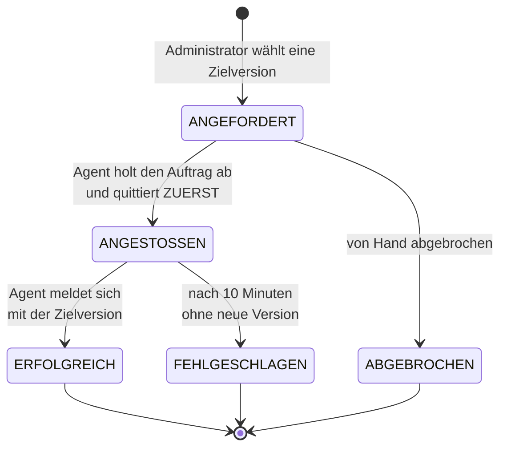

# 36 — Aktualisierung der Standort-Agenten steuern und verifizieren

**Stand:** umgesetzt (13.08.2026) · **Anforderung:** `FA-AGT-100`
· **Vorgabe:** PO, 13.08.2026 · baut auf [Umsetzung 35](35-agent-aktualisierung.md)

---

## Der Anlass

> „Es soll angezeigt werden, welche Version welcher Agent läuft und was die
> aktuelle Version auf GitHub ist. Der Admin soll dann gezielt das Update auf
> dem Agenten anstoßen und nach erfolgreichem Update dieses auch verifizieren
> können."

Der nächtliche Lauf aus Umsetzung 35 zieht irgendwann alle Agenten nach. Das
genügt nicht in zwei Fällen, die am Anfang eines Produkts der Regelfall sind:

1. Eine Fehlerbehebung wird an **genau einem** Standort gebraucht — heute, nicht
   morgen früh um halb vier.
2. Jemand will vor dem Rollout an **einem** Standort sehen, ob die neue Fassung
   trägt.

## Was der Administrator sieht

In der Agentenliste unter „Instanz" trägt jede Zeile eine Spalte
**„Version & Aktualisierung"**. Alles zu einer Frage steht dort beieinander:

| Zeile | Inhalt |
|---|---|
| oben | die laufende Version, daneben eine Marke, wenn etwas Neueres bereitsteht |
| darunter | Auswahlfeld mit den verfügbaren Fassungen und der Knopf „Aktualisieren" |
| bei Bedarf | Zustand des laufenden Auftrags oder Ergebnis des letzten Versuchs |

**Warum alles in einer Zelle:** Die Frage lautet nie „welche Version läuft
dort", sondern immer „läuft dort die richtige, und wenn nicht, was tue ich".
Version, verfügbare Fassungen, Knopf und Ergebnis des letzten Versuchs gehören
deshalb zusammen — sonst springt jemand zwischen Spalten hin und her und
verliert die Zeile.

Die Auswahl steht auf der **neuesten** Fassung, ist aber frei: Manchmal will man
an einem Standort bewusst zurück.

## Zwei Abbilder, nicht eines

Zentrale und Agent liegen als getrennte Abbilder in derselben Programmablage.
Bis heute fragte die Zentrale nur nach Versionen ihres **eigenen** Abbilds. Der
Name des Agent-Abbilds ergibt sich aus dem der Zentrale mit dem Zusatz
`-agent` — dieselbe Konvention, nach der auch veröffentlicht wird. Eine eigene
Einstellung dafür wäre eine weitere Stelle, an der etwas auseinanderlaufen kann.

Scheitert die Abfrage der Agent-Versionen, bleibt die Prüfung der Zentrale davon
unberührt. Sie ist die wichtigere von beiden.

### `stabil` steht nicht zur Auswahl

Ein Agent meldet immer die **Nummer** aus seinem Manifest, nie den Tag, über den
er geholt wurde. Ein Auftrag „aktualisiere auf `stabil`" wäre deshalb **nie
erfüllbar**: Der Agent käme mit `1.2.0` wieder, die Zielversion hieße `stabil`,
und nach zehn Minuten stünde ein Fehlschlag da — obwohl alles geklappt hat.

Aufgefallen ist das erst am laufenden Stack, als `stabil` in der Auswahlliste
auftauchte. Der nächtliche Lauf benutzt den Tag weiterhin; dort wird nichts
verifiziert, sondern nur nachgezogen.

## Der Ablauf

**Der Agent quittiert, bevor er anstößt.** Im Erfolgsfall ersetzt der
Aktualisierungsdienst seinen Container mitten im Satz. Wer danach quittieren
wollte, käme nicht mehr dazu — und in der Zentrale stünde ein Auftrag, den
angeblich niemand angenommen hat.

## Verifikation über die Wirkung

**Nicht die Quittung entscheidet, sondern die Version, mit der der Agent
wiederkommt.** Das ist die ehrlichere Prüfung: Sie misst das Ergebnis und nicht
die Absicht. Ein Agent kann melden, er habe angestoßen, und trotzdem unverändert
weiterlaufen — etwa weil es die Version in der Programmablage gar nicht gibt.

Drei Wege führen zum Abschluss:

| Situation | Was passiert |
|---|---|
| Agent meldet die Zielversion | **erfolgreich**, verifiziert |
| Agent meldet weiter die alte Version, Frist abgelaufen | **fehlgeschlagen** mit Ursachen und Befehl zur Diagnose |
| Agent meldet gar nichts mehr, Frist abgelaufen | **fehlgeschlagen** („bitte prüfen, ob der Container läuft") |

Die Frist beträgt **zehn Minuten**: Abbild holen, Container ersetzen,
hochfahren, erste Meldung sind im LAN Sekunden und über eine schwache
Praxisleitung ein paar Minuten. Ein Auftrag, der ewig „läuft", sieht aus wie
Fortschritt — das ist der Zustand, den die Frist ausschließt.

**Scheitert schon der Anstoß**, endet der Auftrag sofort statt zehn Minuten
Arbeit vorzutäuschen. Der häufigste Fall: Jemand hat die Aktualisierungsdienste
aus dem Paket entfernt, weil das Haus jede Änderung selbst bestimmen will. Dann
lautet die Meldung genau das — und nennt den Befehl für die Aktualisierung von
Hand.

## Wie der Agent sich austauschen lässt

Ein Container kann sich nicht selbst ersetzen. Der Agent **bittet** den
Aktualisierungsdienst darum, über dessen HTTP-Schnittstelle
(`WATCHTOWER_HTTP_API_UPDATE`). Bewusst kein Zugriff auf den Docker-Dienst: Wer
ihn hat, ist faktisch Administrator des Praxisrechners. Der Agent kennt eine
einzige Adresse mit einer einzigen Wirkung — „sieh jetzt nach neuen Abbildern".

Der nächtliche Plan läuft unverändert weiter. Das ist nicht selbstverständlich:
Im reinen Anfragebetrieb ignoriert Watchtower seinen Zeitplan;
`WATCHTOWER_HTTP_API_PERIODIC_POLLS` schaltet beides zusammen. Ohne diesen
Schalter wäre der nächtliche Lauf stillschweigend ausgefallen.

**Das Kennwort dafür wird je Paket neu erzeugt.** Ein festes wäre in jeder
Praxis dasselbe; wer eines kennt, könnte überall Neustarts auslösen. Es wirkt
zwar nur innerhalb eines Rechners — aber ein gemeinsames Geheimnis über hundert
Standorte hinweg ist der Fehler, den man später nicht mehr repariert.

## Was der Nutzer beim Klick erfährt

Die Bestätigung nennt die Folge, nicht die Technik:

> Diesen Agenten jetzt aktualisieren? Er startet dabei neu. Für etwa eine Minute
> werden die Kartenterminals dieses Standorts nicht überwacht; bereits
> freigeschaltete Karten bleiben freigeschaltet.

Der zweite Satz ist der wichtige. „Nicht überwacht" klingt in einer Praxis
schlimmer, als es ist — die Karten bleiben verifiziert, es fehlt nur die
Aufsicht.

Während der Auftrag läuft, lädt sich **nur diese Zelle** alle fünf Sekunden
nach. Die ganze Seite nachzuladen würde jedes offene Menü schließen und jede
Eingabe im Formular darüber verwerfen.

## Zwei Fehler, die dabei aufgefallen sind

**Die Version reiste nur in der Bestandsmeldung mit** — und die wird nur
gesendet, wenn sich am Gerätebestand etwas geändert hat. Nach einem Neustart ist
der Abdruck zwar ohnehin leer, sodass gemeldet wird; verlassen sollte sich
darauf aber nichts, was über Erfolg oder Misserfolg entscheidet. Der Abdruck
enthält jetzt die eigene Version, und die Zentrale schließt Aufträge zusätzlich
im Minutentakt ab.

**Zwei `environment:`-Blöcke** standen beim Dienst `agent` im Einrichtungspaket.
In YAML gewinnt bei doppeltem Schlüssel der letzte — alles darüber fällt weg,
ohne Fehlermeldung. Hier wäre `REGISTRY_VERZEICHNIS` verschwunden und die
selbsttätige Aktualisierung stillschweigend ausgefallen. Ein Kommentarfehler
sieht anders aus als ein Datenverlust; dieser sah aus wie einer.

## Nachgebessert nach dem ersten Blick des PO (14.08.2026)

Vier Befunde aus der laufenden Oberfläche:

**„Die Registry konnte nicht abgefragt werden: null".** Viele Netzwerkausnahmen
tragen keinen Meldungstext. Dieselbe Übersetzung war einen Tag zuvor im Agenten
geschrieben und in der Zentrale vergessen worden — sie liegt jetzt einmal im
gemeinsamen Modul (`Netzfehler.klartext`). Zwei Kopien laufen auseinander, eine
Stelle nicht.

**Widerspruch in der Kopfzeile.** Oben stand „Sicherheitsupdate verfügbar",
darunter „lässt sich nicht abfragen". Die Marke behauptete eine frische
Tatsache aus einem alten Stand. Bei einem Abfragefehler heißt es jetzt
**„Stand unbekannt"**, und die Liste ist ausdrücklich als letzter bekannter
Stand gekennzeichnet. Der Fehler ist in diesem Moment die wichtigere Aussage:
Wir wissen es gerade nicht.

**Der Fehlschlag blieb für immer stehen.** In der Sache richtig — der letzte
Versuch *ist* gescheitert — aber ohne Ausweg. Wer die Ursache behoben hat oder
bewusst nicht aktualisieren will, wurde die Meldung nicht los. Eine Meldung,
die man nicht loswird, wird ignoriert, und dann ignoriert man auch die nächste.
Jetzt gibt es **„Zur Kenntnis"**: Der Hinweis verschwindet aus der Zeile, der
Vorgang bleibt im Verlauf. Ein neuer Fehlschlag zeigt sich wieder.

**Die Zelle war überladen.** Der volle Fehlertext drückte die Tabellenzeile
auseinander; bei dreißig Agenten wird eine Tabelle so unlesbar. Der Befund
bleibt sichtbar, die Begründung liegt einen Klick tiefer — dasselbe Prinzip wie
bei den technischen Fehlercodes im Protokoll. Und der Satz „Keine Versionen
bekannt" stand in **jeder** Zeile, obwohl er eine Eigenschaft der Instanz
beschreibt und nicht des einzelnen Agenten. Er steht jetzt einmal, direkt unter
der Tabelle.

## Nachgewiesen

`AgentenupdateTest` (13 Prüfungen): Auftrag mit Ziel- und Ausgangsversion; kein
Auftrag auf die laufende Version; nur einer gleichzeitig; **Erfolg erst bei der
gemeldeten Zielversion**; Fristablauf mit und ohne Rückmeldung; sofortiges Ende
bei gescheitertem Anstoß; Abbruch und neuer Anlauf; Verlauf bleibt erhalten; ein Fehlschlag lässt sich
zur Kenntnis nehmen, ohne ihn zu löschen; ein laufender Auftrag lässt sich
nicht wegklicken; ein neuer Fehlschlag zeigt sich wieder.

`AgentenpaketTest` (18 Prüfungen, davon 2 neu): HTTP-Schnittstelle samt
periodischem Lauf, Kennwort je Paket verschieden und nur in der `.env` — und
**kein Dienst mit zwei `environment:`-Blöcken**. Dieser Test wurde durch
absichtliche Sabotage gegengeprüft: Er schlägt an.

Systemnachweis `FA-AGT-100` am laufenden Stack: Versionen des Agent-Abbilds
(anderer Satz als der der Zentrale), `stabil` nicht in der Auswahl, Anforderung,
Ablehnung des zweiten Auftrags, Abholung durch den Agenten, sofortiger Fehlschlag
ohne Aktualisierungsdienst, Verifikation über die gemeldete Version,
Fristablauf, und keine Aktualisierung ohne Anmeldung.
