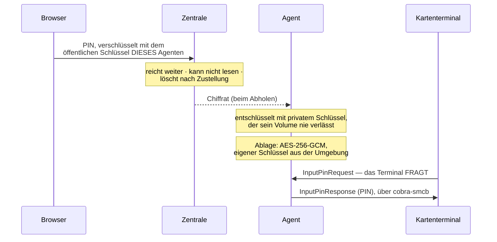
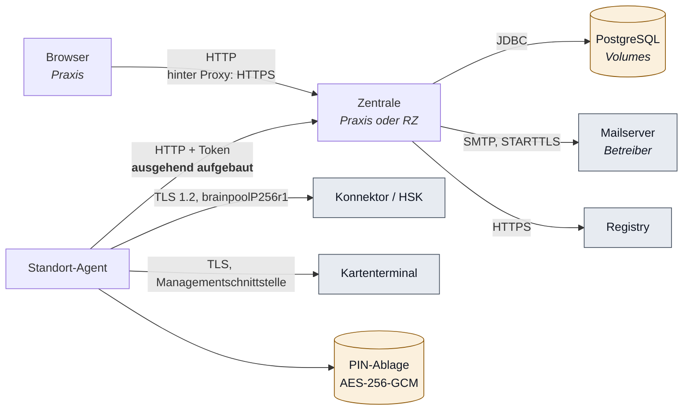

# Sicherheit und Datenschutz

**Stand:** 10.08.2026 · Grundlage: CLAUDE.md (Sicherheitsleitplanke),
[ADR-0002](adr/0002-betriebsmodell-und-systemtopologie.md),
[ADR-0008](adr/0008-ablage-von-geraete-zugangsdaten.md)

> Dieses Dokument beschreibt den **umgesetzten** Stand und benennt Lücken. Es ist
> keine Datenschutz-Folgenabschätzung — die obliegt dem Betreiber als
> Verantwortlichem im Sinne der DSGVO. Es liefert ihm aber die Angaben, die er
> dafür braucht.

---

## 1. Schutzbedarf — woher er kommt

**Der PIN-Roboter verarbeitet keine Patienten- oder Gesundheitsdaten.** Das ist
eine ausdrückliche Festlegung des Product Owners vom 06.08.2026 und im
Datenmodell durchgesetzt: Es gibt kein Feld, das medizinische Angaben aufnehmen
könnte.

Der Schutzbedarf ergibt sich stattdessen aus **einem einzigen Wert**: der
**SMC-B-PIN**.

Warum sie so schwer wiegt:

| | |
|---|---|
| Ihr Missbrauch | sperrt die Karte nach drei Fehlversuchen |
| Folge einer Sperrung | Die Einrichtung verliert ihren TI-Zugang. Kein eRezept, keine eAU, kein KIM. |
| Behebung | Nur mit dem PUK, physisch vor Ort, durch berechtigtes Personal |
| Bei zentralem Betrieb | Eine Zentrale mit allen PINs wäre ein Ziel, dessen Kompromittierung gleichzeitig hunderte Praxen lahmlegt |

Die gematik regelt das ausdrücklich: `A_24114` erlaubt die Vorhaltung der PIN nur
für Clients, deren Sicherheit die betreibende Organisation durchsetzen kann.

**Einstufung:** Reine Organisationssoftware, **kein Medizinprodukt**, kein
MDR-Verfahren (Festlegung PO, 06.08.2026).

---

## 2. Personenbezogene Daten — welche, wo, wie lange

| Datum | Wo | Zweck | Rechtsgrundlage (Einschätzung) |
|---|---|---|---|
| Benutzername, Anzeigename | Zentrale, Tabelle `benutzer` | Anmeldung, Zurechnung von Handlungen | Art. 6 Abs. 1 lit. b/f DSGVO — Beschäftigungsverhältnis, berechtigtes Interesse an Nachvollziehbarkeit |
| Kennwort-Hash (Argon2id) | Zentrale | Anmeldung | wie oben |
| TOTP-Geheimnis | Zentrale | zweiter Faktor | wie oben |
| Anzeigename im Fachprotokoll | Zentrale, `fachprotokoll.ausloeser` | **Nachvollziehbarkeit**: welche Person hat gehandelt | Art. 6 Abs. 1 lit. f — der Roboter handelt selbsttätig, seine Auslösung muss zurechenbar sein |
| Sitzungskennung | Zentrale, `sitzung` | Anmeldung aufrechterhalten | Art. 6 Abs. 1 lit. b |
| E-Mail-Adressen der Empfänger | Zentrale, `mail_regel.empfaenger` | Benachrichtigung bei Alarmen (FA-ALA-020) | Art. 6 Abs. 1 lit. f — berechtigtes Interesse an Betriebssicherheit |

**Nicht** verarbeitet: Patientendaten, Gesundheitsdaten, eGK-Inhalte,
HBA-Inhalte. eGK und HBA sind technisch ausgeschlossen (`A_24080` erlaubt PEviM
nur für SMC-B).

**Speicherdauer:** Benutzerkonten so lange, wie das Konto besteht.
Protokolleinträge bis zur Rotation — die greift nach Speicherbudget, nicht nach
Frist.

> **Gelöst seit 07.08.2026: Pseudonymisierung statt Löschung.** Nach einer
> konfigurierbaren Frist (Vorgabe **183 Tage**, `PSEUDONYM_FRIST_TAGE`) wird der
> Anzeigename im Protokoll durch eine Kennung ersetzt:
> `"Anna Beispiel"` → `"Person 7"`.
>
> Die **Handlung** bleibt vollständig nachvollziehbar — was geschah, wann, an
> welchem Gerät, mit welchem Ergebnis. Verloren geht nur die Zuordnung zu einer
> natürlichen Person, und genau das ist der Zweck.
>
> Eine Kennung statt eines leeren Feldes, weil sonst nicht mehr unterscheidbar
> wäre, ob zwei Einträge von derselben Person stammen. Sie ist aus der
> Benutzer-Kennung abgeleitet, nicht aus dem Namen.
>
> Rollen ohne Personenbezug (`System`, `Standort-Agent`, `Registrierung`)
> bleiben unberührt. Die Frist lässt sich auf `0` setzen — das ist eine bewusste
> Entscheidung des Betreibers und wird angezeigt.
>
> **Was das nicht ist:** ein Löschen auf Zuruf. Ein einzelnes Löschbegehren vor
> Fristablauf lässt sich weiterhin nicht erfüllen — das Protokoll ist ein
> Nachweis, und ein Nachweis mit Lücken ist keiner. Die Abwägung nach
> Art. 17 Abs. 3 lit. b/e DSGVO obliegt dem Betreiber.

---

## 3. Die Geheimnisse und wo sie liegen

Drei Arten, streng unterschieden:

| | SMC-B-PIN | Geräte-Zugang | Anmeldekennwort | Mailserver-Kennwort |
|---|---|---|---|---|
| Beispiel | PIN.SMC | Konnektor-Anmeldung, Terminal-Admin | Kennwort eines Benutzers | SMTP-Anmeldung |
| In der Zentrale | **nie** | verschlüsselt (AES-256-GCM) | nur als Argon2id-Hash | verschlüsselt (AES-256-GCM) |
| Beim Agenten | ja, verschlüsselt | ja (bezogen) | nein | nein |
| Wiederherstellbar | nur vom Agenten | ja, mit dem Schlüssel | nein, bewusst | ja, mit dem Schlüssel |
| Begründung | `A_24114`, ADR-0009 | ADR-0008 | Stand der Technik | wie Geräte-Zugang |

Dazu drei Schlüssel, die selbst Geheimnisse sind:

| Schlüssel | Wo | Schützt | Bei Verlust |
|---|---|---|---|
| `GEHEIMNIS_SCHLUESSEL` | Umgebung der Zentrale | Geräte-Zugänge, Mailserver-Kennwort | Werte unbrauchbar, neu einzugeben |
| `PIN_ABLAGE_SCHLUESSEL` | Umgebung des Agenten | hinterlegte SMC-B-PINs | PINs neu zu hinterlegen |
| privater Schlüssel des Agenten | Volume des Agenten, Datei mit Eigentümerrechten | Entgegennahme der PIN aus dem Browser | PINs neu zu hinterlegen |

**Die beiden ersten sind bewusst getrennt.** Wer den einen erlangt, bekommt
damit nicht auch den anderen — sie liegen in verschiedenen Containern und
schützen verschiedene Werte.

**Warum die PIN nie in der Zentrale liegt:** Sie ist der eine Wert, dessen
Missbrauch die Einrichtung handlungsunfähig macht. Bei zentralem Betrieb für
viele Einrichtungen wäre eine zentrale PIN-Ablage nicht verantwortbar.
Ausführlich: ADR-0002, ADR-0008.

**Was die Verschlüsselung der Geräte-Zugänge nicht leistet:** Wer Datenbank
*und* Schlüssel hat, kann entschlüsseln. Das ist unvermeidbar, solange der Wert
wieder verwendbar sein muss. Der Schutz richtet sich gegen Sicherungen,
Datenauszüge und versehentliche Ausgaben — nicht gegen vollen Systemzugriff.
Auch das steht so in ADR-0008, statt beschönigt zu werden.

### Wie die PIN vom Browser zum Agenten kommt (ADR-0009)

Die PIN wird in der Oberfläche eingegeben — und die läuft in der Zentrale, die
sie nie sehen darf. Aufgelöst wird der Widerspruch durch
**Ende-zu-Ende-Verschlüsselung**:

Der Klartext existiert an genau zwei Stellen: im Browser des Bedieners, für
Sekundenbruchteile, und im Agenten. **Nirgends dazwischen.**

| Zusage | Wie durchgesetzt | Nachweis |
|---|---|---|
| Die Zentrale sieht nie Klartext | RSA-OAEP 3072, privater Teil nur beim Agenten | Systemnachweis: unverschlüsselte Eingabe wird abgewiesen |
| Kein Chiffrat bleibt liegen | nach Zustellung aus der Datenbank entfernt | `SELECT count(*) … WHERE chiffrat IS NOT NULL` = 0 |
| Nichts davon im Protokoll | protokolliert wird nur *dass*, für welche Karte, von wem | Suche nach PIN und Chiffrat in Protokoll und Ausgaben |
| Beim Agenten verschlüsselt | AES-256-GCM, eigener Schlüssel | Ablagedatei gelesen, PIN nicht enthalten |
| In der Oberfläche nur das Kennzeichen | „PIN hinterlegt", nie der Wert | HTML geprüft |

**Was das nicht leistet:** Wer den Agenten vollständig kontrolliert, kommt an
die PIN — er muss sie ja verwenden können. Der Gewinn liegt woanders: Bei 1.000
Standorten liefert ein Angriff auf die Zentrale **keine einzige** PIN.

### Die letzte Strecke: Agent → Kartenterminal (ADR-0011)

Seit dem 10.08.2026 ist diese Strecke anders gebaut, und sie hat eine eigene
Bedrohungslage. Bis dahin galt die Annahme: *Der Agent entscheidet, wann eine
PIN das Haus verlässt.* Diese Annahme ist falsch.

> **Solange die Verbindung zum Terminal steht, kann jede Stelle am Konnektor
> eine PIN-Anfrage auslösen** — ein Primärsystem, ein Administrator, ein
> Kartenwechsel. Der Agent sieht nur die Frage, nicht ihren Urheber.

Daraus folgen vier Maßnahmen:

| Maßnahme | Wogegen | Durchsetzung |
|---|---|---|
| Verbindung nur, wo eine PIN hinterlegt ist | eine offene Verbindung ohne Zweck ist Angriffsfläche und sperrt zugleich den einzigen Verbindungsplatz | Sollzustandsabgleich in jedem Durchgang |
| **Vollständige Sicherungsprüfung bei jeder Anfrage** | fremd ausgelöste Verifikationen, die den Fehlversuchszähler verbrauchen | `Sicherungspruefung` im Antwortpfad, nicht nur beim Auslösen |
| Kenntnisstand höchstens 90 s alt | Antworten auf Grundlage veralteter Zählerstände | Zeitstempel je Karte; ist er zu alt, wird abgelehnt |
| Unbekannter Slot → Ablehnung | eine PIN an die falsche Karte, also ein sicherer Fehlversuch | Slot-Zuordnung aus `SlotId`, in jedem Durchgang neu aufgebaut |

**Warum 90 Sekunden vertretbar sind.** Den Zähler im Antwortpfad frisch zu holen
scheidet aus — dieser Aufruf beträfe dieselbe Karte, die der Konnektor gerade
bearbeitet. Der Schutz hängt deshalb nicht an der Frische eines Wertes, sondern
an einer Kette: Es wird nur bei **mehr als einem** verbleibenden Versuch
gehandelt, und **jeder erkannte Rückgang** hält die Automatik an. Ein unbemerkter
Fremdversuch senkt den Zähler und wird im nächsten Durchgang erkannt.

**Kryptographie auf dieser Strecke:** Challenge-Response mit CMAC-AES256; der
Schlüssel gilt 30 Sekunden und wird nach genau einer Antwort verworfen. Die PIN
wird vor dem Senden auf reine Ziffern geprüft — ohne das ließe sich über eine
PIN mit Anführungszeichen die Nachricht manipulieren.

Einzelheiten: [03-umsetzung/29](03-umsetzung/29-remote-smcb-api.md).

### Wer die Organisationsstruktur ändern darf (FA-ORG-020)

Der Geltungsbereich eines Benutzers ergibt sich aus dem Baum: seine Einheit und
alles darunter. **Wer den Baum ändern darf, ändert damit Geltungsbereiche —
auch seinen eigenen.** Ein Standortadministrator, der eine fremde Praxis unter
seinen Standort hängen könnte, hätte Zugriff auf deren Geräte, Protokolle und
Konten, ohne dass an der Mandantentrennung selbst etwas kaputt wäre.

Vier Regeln, jede einzeln nachgewiesen:

1. **Erst ab Standortebene.** Wer eine Praxis betreut, legt keine weiteren an.
2. **Das Elternteil muss im eigenen Bereich liegen** — sonst ließen sich
   Geschwister anlegen und der eigene Bereich erweitern.
3. **Beim Umhängen müssen Einheit *und* Ziel im Bereich liegen.** Nur das Ziel
   zu prüfen erlaubt die Übernahme fremder Einheiten; nur die Einheit zu prüfen
   das Wegschieben aus dem Bereich.
4. **Kein Zyklus** — sonst wird ein Teilbaum abgetrennt und ist für niemanden
   mehr sichtbar, auch nicht für den Instanzbetreiber.

Umhängen und Löschen sind **Sicherheitsereignisse** im Fachprotokoll, Umbenennen
ist Routine: protokolliert wird nach Wirkung, nicht nach Vorgang.

---

## 4. Technische und organisatorische Maßnahmen

### Umgesetzt und nachgewiesen

| Maßnahme | Umsetzung | Nachweis |
|---|---|---|
| **Zugangskontrolle** | Benutzername + Kennwort + TOTP, nicht abschaltbar | Systemnachweis: keine Oberflächenseite ohne Sitzung erreichbar |
| **Kennwortstärke** | eigene Prüfung, lehnt schwache und naheliegende Kennwörter ab | Modultests |
| **Kennwortablage** | Argon2id | Modultests |
| **Zweiter Faktor** | TOTP nach RFC 6238, gegen die offiziellen Testvektoren geprüft | Modultests gegen RFC-Vektoren |
| **Einmalkennwort gilt einmal** | verbrauchte Codes werden abgewiesen | Systemnachweis |
| **Rollentrennung** | Administrator / Benutzer, **zusätzlich nach Ebene** (Instanz / Verbund / Standort / Einrichtung); Abweisungen nennen die eigene Berechtigung | 8 Tests, Systemnachweise mit HTTP 403 |
| **Mandantentrennung** | `Geltungsbereich` als Pflichtparameter jeder mandantengebundenen Abfrage — Bestand, Ermittlung, Protokoll, Export, Alarme, Gruppen, Benutzerliste. Keine Zuordnung heißt „sieht nichts" | 22 Tests inkl. Angriffe über manipulierte Kennungen; Systemnachweise mit echter Anmeldung |
| **Agent-Authentisierung** | einmalig gültiges Registrierungsgeheimnis → dauerhaftes Token | Systemnachweise: erfundenes und wiederverwendetes Geheimnis werden abgewiesen |
| **Transportverschlüsselung TI** | TLS 1.2 mit Brainpool (BouncyCastle), Cipher-Suites nach `[gemSpec_Krypt]` eingeschränkt | Durchstich über Brainpool-TLS |
| **Zugangsdaten nicht auslesbar** | AES-256-GCM, kein Lesepfad gibt Klartext | Systemnachweise: kein Kennwort auf einer Oberflächenseite, keins im Protokoll |
| **Keine Geheimnisse in Protokollen** | zentral erzwungen, nicht durch Sorgfalt an Einzelstellen | Systemnachweis sucht PIN und Kennwörter in Agent-Ausgabe und Fachprotokoll |
| **Keine Geheimnisse im Repository** | `.gitignore`, Konfiguration nur über Umgebung | — |
| **Unveränderliches Fachprotokoll** | Änderung und Löschung sind unterbunden; nur die Rotation darf löschen | Systemnachweis und Modultest |
| **Nachvollziehbarkeit** | jede Handlung mit Auslöser, Zeitpunkt, Gerät, Ergebnis | 4 Sichten, Excel-Export |
| **Nicht-Root im Container** | Dockerfile | — |
| **Not-Aus** | hält die Automatik sofort an | Systemnachweis: 0 Versuche bei aktivem Not-Aus |
| **Kartenschutz** | `LeftTries` wird vor jedem Versuch geprüft; Abbruch statt Wiederholung | `FA-PIN-030`: genau **ein** Versuch bei falscher PIN, verpflichtend vor jeder Auslieferung |
| **Verfügbarkeit** | Agent arbeitet ohne Zentrale weiter; volles Protokoll hält die Kernfunktion nicht an | Systemnachweise |
| **PIN-Übergabe Ende-zu-Ende** | Browser verschlüsselt mit dem öffentlichen Schlüssel des Agenten (RSA-OAEP 3072); die Zentrale reicht nur weiter und löscht nach Zustellung | 5 Systemnachweise, 10 Modultests — [ADR-0009](adr/0009-pin-hinterlegen-ueber-die-oberflaeche.md) |
| **PIN-Ablage beim Agenten** | AES-256-GCM, eigener Schlüssel aus der Umgebung; ohne Schlüssel wird nichts auf die Platte geschrieben | Systemnachweis liest die Ablagedatei |
| **Strukturänderungen begrenzt** | Organisationseinheiten erst ab Standortebene; Umhängen prüft Einheit *und* Ziel; Zyklen abgewehrt | 17 Modultests, davon die Mehrzahl Angriffsversuche |
| **Kein Verifikationsversuch bei laufendem Update** | Zustand „aktualisierend" wird ausgewertet, auch beim konnektorweiten KSR-Lauf | 0 Versuche bei 4 gleichzeitig betroffenen Terminals ([gemSpec_Kon] 4.3.10) |
| **Keine Mailflut** | Sammelfenster je Einrichtung, Vorgabe 5 Minuten | 50 Alarme ergeben eine Mail, gegen einen Auffangserver gemessen |
| **Keine Geheimnisse in Mails** | der Text nennt nur Vorgang, Gerät und Handlung | Systemnachweis durchsucht alle eingegangenen Nachrichten |
| **Einrichtung aus der Registrierung** | Der Agent kann seine Einrichtung nicht selbst behaupten — sie stammt aus dem Registrierungscode, den ein Administrator erzeugt hat. Ein übernommener Agent kann keine Geräte in eine fremde Einrichtung unterschieben | Systemnachweis meldet ausdrücklich eine fremde Einrichtung; es kommt nichts davon an |
| **Startkonto verändert nichts** | Ein per Konfiguration vorgegebenes Administratorkonto entsteht nur, wenn es fehlt. Ein vorhandenes Konto wird nie zurückgesetzt — sonst verschaffte sich jemand mit Schreibzugriff auf die Konfiguration per Neustart erneut Zutritt | Systemnachweis: deaktiviertes Konto bleibt nach Neustart deaktiviert |
| **Keine Geheimnisse aus der Konfiguration im Protokoll** | Passwort und TOTP-Geheimnis des Startkontos erscheinen weder im Betriebs- noch im Fachprotokoll | Systemnachweis durchsucht das Containerlog |
| **Sicherung verlässt die Instanz nur verschlüsselt** | AES-256-GCM, Schlüssel aus Argon2id über eine Passphrase, eigener Salt je Datei. Der Kopf ist als AAD mitgeschützt | 18 Systemnachweise; ein einzelnes verändertes Byte wird erkannt |
| **Der Sicherungsschlüssel wird nicht gespeichert** | Weder Datenbank noch Protokoll noch Speicher über den Vorgang hinaus; `char[]` wird überschrieben | Systemnachweis durchsucht Fachprotokoll und Containerlog |
| **Kein Pfadausbruch über Dateinamen** | Der Name einer Sicherung darf keine Pfadanteile enthalten und muss einem vorhandenen Stand entsprechen | Systemnachweis mit `../../etc/passwd` → HTTP 404 |
| **Wiederherstellung ganz oder gar nicht** | `pg_restore --single-transaction`; davor entsteht eine Sicherheitskopie | Systemnachweis am laufenden System |
| **Stille Datenbankfehler beseitigt** | 20 Stellen verschluckten `SQLException`. Ein stiller SQL-Fehler ist unauffindbar und kann eine fehlerhafte Zugriffsbedingung verdecken — so blieb ein defektes `WHERE` monatelang unentdeckt | Codeanalyse 10.08.2026, [10-codeanalyse.md](10-codeanalyse.md) |

### Offen — ehrlich benannt

1. **Mandantentrennung: vollständig umgesetzt** (Stand 10.08.2026 — der
   folgende Absatz beschreibt den Weg dorthin).

   Seit dem 09.08.2026 gilt sie auch für Geräte, Alarme und Protokolleinträge,
   die ein Agent meldet: Vorher trug alles hart die Einrichtung `"Praxis"`,
   womit ein Administrator der einen Praxis die Terminals der anderen gesehen
   hätte. Die Einrichtung stammt jetzt aus der Registrierung des Agenten.

   Historischer Stand:

   Seit dem 07.08.2026 erzwingt ein `Geltungsbereich` die Trennung bei
   Konnektoren, Kartenterminals, Organisationsauswahl, Filterwerten,
   Massenaktionen und der Bestandsermittlung — **zentral, nicht in jeder
   Abfrage von Hand**: Die Methoden verlangen ihn als Pflichtparameter, wer ihn
   weglässt bekommt einen Übersetzungsfehler.
   Nachweis: `MandantentrennungTest` (16 Tests, darunter Angriffe über
   manipulierte Kennungen), dazu Systemnachweise über HTTP.

   **Seit dem 07.08.2026 gilt sie auch für Fachprotokoll, Alarme,
   Gerätegruppen und die Benutzerliste** (Migration 12 trägt eine
   `organisation_id` nach, mit Übernahme aus dem Textfeld). Der Excel-Export
   ist mit eingeschränkt — er wäre sonst der bequemste Weg an fremde Daten.
   Nachweis: 22 Tests, dazu Systemnachweise mit echter Anmeldung.

   **Seit dem 07.08.2026 ergänzt um Rechte je Ebene** ([Umsetzung](03-umsetzung/11-rechte-je-ebene.md)):
   Organisationen anlegen erst ab Standortebene, instanzweite Werkzeuge nur für
   den Instanzbetreiber. **Was bleibt:** Neue Funde aus der Bestandsermittlung
   haben noch keine Zuordnung — die Grenze greift dort bei der Übernahme.
2. **Kein TLS auf der eigenen Oberfläche.** Die Zentrale spricht HTTP. Für den
   Zugriff über ein Netzsegment hinaus gehört ein TLS-Vermittler davor — nicht
   umgesetzt, nicht dokumentiert.
3. **Keine Löschfrist / Pseudonymisierung im Protokoll** (Abschnitt 2).
4. **Abhängigkeits-Scan: Skript vorhanden, Erfassung unvollständig.**
   `pruefungen/abhaengigkeiten-pruefen.sh` prüft feste Versionen und gleicht
   gegen die OSS-Index-Datenbank ab. **Es erfasst derzeit nur 4 von rund 20
   Abhängigkeiten** — Javalin und der PostgreSQL-Treiber fehlen, weil
   `dependency:list` sie in dieser Aufrufform nicht ausgibt. Das Skript meldet
   das ausdrücklich als Fehlschlag, statt „bestanden" zu sagen: Ein Scan, der
   die Hälfte übersieht und Erfolg meldet, erzeugt eine Sicherheit, die es nicht
   gibt. **Zu beheben, bevor er als Nachweis zählt.**
5. **Begrenzung fehlgeschlagener Anmeldungen: umgesetzt.** Neben der Kontosperre
   bremst jetzt eine Absenderbremse (`Anmeldebremse`): Nach 5 Fehlversuchen
   wächst die Antwortzeit, gedeckelt bei 30 Sekunden, Verfall nach 15 Minuten
   ohne Fehlversuch. Bewusst **bremsen statt sperren** — eine harte Sperre träfe
   eine ganze Praxis hinter einem gemeinsamen Anschluss, und ein Angreifer
   könnte sie gezielt auslösen, um Personal auszusperren.
   *Grenze:* Die Zählung liegt im Arbeitsspeicher, je Instanz. Ein Neustart
   setzt sie zurück. Für eine Zentrale je Einrichtung angemessen; eine Ablage
   in der Datenbank wäre ein Schreibvorgang je Anmeldeversuch — genau das, was
   ein Angreifer auslösen möchte.
6. **Kein Vier-Augen-Prinzip** für kritische Aktionen (PIN hinterlegen,
   Not-Aus aufheben). Nicht gefordert, aber in einer Klinik erwägbar.
7. **Der Not-Aus wirkt instanzweit, nicht je Einrichtung.** Bei mehreren
   Mandanten an einer Zentrale hält ein Praxisadministrator damit auch fremde
   Standorte an. Bewusst so belassen: Die Alternative wäre, ihn für
   Praxisadministratoren zu sperren, und bei einem Sicherheitsmittel ist das die
   schlechtere Wahl. Der Umbau auf einen Not-Aus je Einrichtung berührt auch den
   Agenten, der den Zustand global abfragt.
7. **Kalibrierung an echter Hardware** (ADR-0007). Alle Aussagen über das
   Verhalten von Konnektor und Terminals beruhen auf dem Simulator.

---

## 5. Datenflüsse

**Was über welche Verbindung geht:**

| Verbindung | Inhalt | Enthält Geheimnisse? |
|---|---|---|
| Browser → Zentrale | Bedienung, Kennwörter bei der Eingabe | ja, beim Eintragen — deshalb gehört TLS davor |
| Agent → Zentrale | Gerätezustände, Ereignisse, ermittelter Bestand | **nein**, keine PIN, kein Kennwort |
| Zentrale → Agent | Not-Aus-Zustand (Abruf durch den Agenten) | nein |
| Agent → Konnektor | Aufrufkontext, Kartenhandle, PIN-Status | Zugangsdaten des Konnektors |
| Agent → Terminal | PEviM, **PIN** | **ja, die PIN** |
| Browser → Zentrale (PIN) | **Chiffrat**, im Browser verschlüsselt | nein — die Zentrale kann es nicht lesen (ADR-0009) |
| Zentrale → Agent (PIN) | dasselbe Chiffrat, danach gelöscht | nein, für die Zentrale unlesbar |
| **Zentrale → Mailserver** | Alarmtext: Einrichtung, Gerätekennung, Handlungsempfehlung | **nein** — keine PIN, keine Zugangsdaten, keine personenbezogenen Daten |

**Verbindungen nach außen — vollständig aufgezählt.** Bis zum 08.08.2026 stand
hier „keine Verbindung nach außen". Mit der Benachrichtigung per E-Mail
(FA-ALA-020) stimmt das nicht mehr, und das gehört benannt statt
fortgeschrieben. Es sind genau zwei:

1. **Der Mailserver des Betreibers**, wenn eine Benachrichtigungsregel
   eingerichtet ist. Ohne Regel wird nichts versendet — die Voreinstellung ist
   „keine Regel". Wohin gesendet wird, bestimmt allein der Betreiber; der
   Roboter kennt keine fest eingebaute Adresse.
2. **Die Container-Registry** beim Aktualisieren, bewusst angestoßen.

Weiterhin gilt: keine Telemetrie, keine Fehlerberichte an Dritte, keine
Auftragsverarbeitung, keine Verbindung zu uns als Hersteller.

**Was in einer Benachrichtigung steht — und was nicht.** Eine Mail verlässt das
Haus, läuft über fremde Server und liegt danach in einem Postfach, dessen
Schutz wir nicht kennen. Sie nennt deshalb nur: was geschehen ist, an welchem
Gerät, und was zu tun ist. **Keine PIN, kein Chiffrat, keine Zugangsdaten,
keine personenbezogenen Daten.** Der Text sagt das in seiner letzten Zeile auch
selbst.

Nachgewiesen wird es gegen einen Auffangserver: Der Systemnachweis durchsucht
*alle* dort eingegangenen Nachrichten nach den Test-PINs und -Kennwörtern des
Laufs.

**Verschlüsselung ist Vorgabe**, abschaltbar nur für Mailserver im eigenen Netz,
die kein STARTTLS anbieten — und die Oberfläche sagt dann, was das bedeutet.
Der Zertifikatsname wird geprüft; ohne diese Prüfung würde jedes gültige
Zertifikat angenommen, auch ein fremdes.

---

## 6. Was der Betreiber tun muss

Diese Punkte kann die Software nicht für ihn erledigen:

1. **`GEHEIMNIS_SCHLUESSEL` erzeugen und sichern** — aber nicht in derselben
   Datei wie den Datenbankauszug ([Betrieb, Abschnitt 3](04-betrieb.md)).
2. **Sicherungen an einen anderen Ort bringen** und die Wiederherstellung
   mindestens einmal selbst erproben.
3. **TLS-Vermittler** einrichten, wenn die Oberfläche über das lokale
   Netzsegment hinaus erreichbar sein soll.
4. **Konten von ausgeschiedenem Personal deaktivieren.** Die Software erinnert
   nicht daran.
5. **Verzeichnis von Verarbeitungstätigkeiten** ergänzen — Abschnitt 2 liefert
   die Angaben.
6. **Zugriff auf den Docker-Host beschränken.** Er ist der Punkt, an dem alle
   technischen Maßnahmen dieses Dokuments endeten.
7. **`PIN_ABLAGE_SCHLUESSEL` erzeugen und sichern** — getrennt vom
   `GEHEIMNIS_SCHLUESSEL` aufbewahren, sonst ist die Trennung wertlos.
8. **Empfängeradressen aktuell halten.** Eine Benachrichtigung an ein Postfach,
   das niemand mehr liest, ist schlimmer als keine: Sie erzeugt das Gefühl,
   informiert zu sein.
9. **Prüfen, ob der eigene Mailserver zu einem Anbieter außerhalb der EU
   gehört.** Der Roboter sendet dorthin, wohin der Betreiber ihn richtet —
   die Beurteilung des Drittlandtransfers obliegt ihm.

---

## Nachtrag 12.08.2026: Eine Mandantengrenze, die von einem Namen abhing

Instanzweite Vorgänge — Anmeldungen, Benutzerverwaltung, Sicherungen,
Protokollrotation — trugen im Fachprotokoll die Einrichtung `"Praxis"`.

Das Modell dahinter ist richtig: Ein Eintrag, dessen Einrichtungsname zu **keiner**
Organisationseinheit passt, bekommt keine `organisation_id` und bleibt für
eingeschränkte Benutzer unsichtbar. Genau das braucht man für Vorgänge ohne
Einrichtungsbezug.

> **Der Platzhalter konnte aber jederzeit zu einer echten Einrichtung werden.**
> Legt jemand eine Praxis namens „Praxis" an, kippen schlagartig alle
> Instanzereignisse in ihren Geltungsbereich — ein Praxisadministrator sähe
> Anmeldungen, Sicherungen und Benutzeränderungen der gesamten Instanz.

Eine Mandantengrenze, die von einem frei wählbaren Namen abhängt, ist keine.

### Was gilt

| | |
|---|---|
| Kennzeichnung | `Fachprotokoll.INSTANZ = "(instanzweit)"` |
| Abgesichert | Die Organisationsverwaltung weist diesen Namen ab — beim Anlegen **und** beim Umbenennen |
| Wirkung | Der Eintrag bekommt keine `organisation_id` und bleibt eingeschränkten Benutzern verborgen |

Die Kollision ist damit nicht mehr unwahrscheinlich, sondern ausgeschlossen.

### Was nicht instanzweit ist

Drei Stellen waren fälschlich als instanzweit eingeordnet: Ereignisse der
**Automatik**, die Zuordnung eines Geräts zu einer Gruppe und Massenaktionen im
Bestand. Sie tragen jetzt die Einrichtung ihres Geräts.

Das ist der wichtigere Teil: Ohne die Korrektur stünden Freischaltungen,
Fehlschläge und PIN-Übergaben weiterhin unter „Praxis" — also genau die
Einträge, die eine Praxis am dringendsten sehen muss, unter einem Namen, der
nicht ihrer ist.

Eine **Massenaktion** kann Geräte mehrerer Betriebsstätten betreffen. Betrifft
sie genau eine, trägt der Eintrag diese; sonst ist er instanzweit. Eine
willkürlich herausgegriffene Einrichtung wäre schlechter als keine.

### Zwei verwandte Blindstellen, im selben Zug behoben

- Die **Lage-Übersicht** fragte Alarme fest für „Praxis" ab. In einem MVZ zeigte
  die Kernsicht des Produkts keinen einzigen Alarm.
- Die **Gruppenauswahl** der Massenaktion und der **Alarmzähler** der Kopfzeile
  ebenso — die eine blieb leer, der andere stand dauerhaft auf null.

Der Geltungsbereich war in allen Fällen längst da und ist die richtige Grenze.
Die zusätzliche Einschränkung auf einen Einrichtungsnamen war ein Rest aus der
Zeit, als es nur eine gab.

### Bestehende Einträge bleiben unverändert

Das Fachprotokoll ist nur anfügbar (FA-PRO-010), und eine Datenbankregel
erzwingt das. Alte Einträge tragen weiterhin „Praxis" — sie umzuschreiben wäre
ein Verstoß gegen die Unveränderlichkeit. Der erste Anlauf des zugehörigen
Modultests wollte genau das und scheiterte an der Regel: Die Zusage gilt auch
für Tests.
