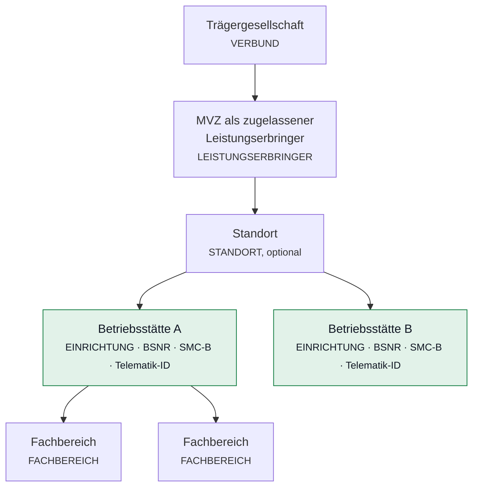

# ADR-0012 — Die Gerätehierarchie folgt der Organisationsstruktur

**Status:** angenommen · **Datum:** 12.08.2026
· **Vorgabe:** PO, 12.08.2026 · **Löst ab:** Teile von [ADR-0002](0002-betriebsmodell-und-systemtopologie.md)

---

## Anlass

Das Datenmodell bildete eine Annahme ab, die es so nicht mehr gibt:

> Ein Konnektor gehört zu genau **einer** Einrichtung.

Das war die ursprüngliche Vorgabe der TI und stimmt für die Einzelpraxis. Mit
**Konnektor as a Service** im Rechenzentrum stimmt sie nicht mehr: Dort teilen
sich mehrere Leistungserbringer einen Konnektor — typischerweise kleine
Einrichtungen mit wenigen Terminals.

Zweitens fehlte unterhalb der Betriebsstätte eine Ebene. In einer Klinik oder
einem größeren MVZ stehen die Kartenterminals nicht „irgendwo in der
Betriebsstätte", sondern in einem **Fachbereich**.

---

## Was fachlich gilt

### Die Organisationsebenen

**Die Betriebsstätte ist die Leistungserbringerinstitution (LEI).** Sie trägt
BSNR, SMC-B und Telematik-ID — über die Telematik-ID wird die institutionelle
Identität technisch abgebildet. In der Regel braucht **jede Betriebsstätte eine
eigene SMC-B**; die Zuordnung erfolgt über die Betriebsstättendaten
beziehungsweise die BSNR und ist mit der zuständigen KV abzustimmen.

Das MVZ selbst ist der zugelassene Leistungserbringer; seine medizinischen
Betriebsstätten werden in der TI als Leistungserbringerinstitutionen geführt.

### Konnektor und HSK

| | TI 1.0 (Konnektor) | TI 2.0 (TI-Gateway mit HSK) |
|---|---|---|
| Ursprüngliche Regel | ein Konnektor → **eine** LEI | — |
| Heute | im Rechenzentrum teilen sich **mehrere LEI** einen Konnektor | feste Zuordnung **HSK-Instanz → eine LEI** |
| Umgekehrt | eine LEI kann **mehrere** Konnektoren betreiben | — |

Daraus folgt: **Konnektor ↔ Einrichtung ist n:m**, HSK ↔ Einrichtung bleibt 1:1.

### Die Geräteebene

Ein Kartenterminal gehört

- **immer zu einem Fachbereich** — oder, wo es keine Fachbereiche gibt, zur
  Betriebsstätte selbst,
- **immer zu einem Konnektor**, über den es angesprochen wird.

Ein Konnektor kann Terminals **mehrerer Fachbereiche** bedienen — und im
RZ-Betrieb auch Terminals mehrerer Betriebsstätten.

---

## Entscheidung

### 1. Zwei neue Organisationsarten

`LEISTUNGSERBRINGER` zwischen Verbund und Standort, `FACHBEREICH` unterhalb der
Einrichtung. Die erlaubte Schachtelung:

| Ebene | erlaubt darunter |
|---|---|
| `VERBUND` | `LEISTUNGSERBRINGER`, `STANDORT`, `EINRICHTUNG` |
| `LEISTUNGSERBRINGER` | `STANDORT`, `EINRICHTUNG` |
| `STANDORT` | `EINRICHTUNG` |
| `EINRICHTUNG` | `FACHBEREICH` |
| `FACHBEREICH` | — |

**Alle Zwischenebenen bleiben optional.** Eine Einzelpraxis ist weiterhin
`VERBUND → EINRICHTUNG`, ohne Leistungserbringer, ohne Standort, ohne
Fachbereich. Ein Modell, das für den einfachsten Fall vier Ebenen erzwingt,
wäre in einer Praxis mit drei Geräten eine Zumutung.

### 2. Die Betriebsstätte trägt ihre TI-Identität

`bsnr` und `telematik_id` an der Organisationseinheit — gefüllt nur bei
`EINRICHTUNG`, denn nur sie ist die LEI. Beides ist **optional**: Beim Einrichten
liegen die Angaben oft noch nicht vor, und eine Pflichtangabe, die niemand hat,
führt zu Fantasiewerten.

Die BSNR ist neunstellig; geprüft wird die Form, nicht die Gültigkeit — das
kann nur die KV.

### 3. Konnektor ↔ Einrichtung wird n:m — mit einem Betreiber

Eine Zuordnungstabelle `konnektor_nutzung`. Zusätzlich behält der Konnektor
**eine betreibende Organisation**:

> **Wer den Konnektor betreibt, verwaltet ihn. Wer ihn nutzt, sieht ihn.**

Das ist der sicherheitsrelevante Teil dieser Entscheidung. Im RZ-Betrieb gehört
der Konnektor dem Dienstleister; die nutzenden Einrichtungen müssen ihn sehen —
sonst könnten sie ihre eigenen Terminals nicht zuordnen —, dürfen aber weder
seine Zugangsdaten ändern noch ihn löschen. Ohne diese Trennung könnte eine
kleine Praxis den Konnektor umkonfigurieren, an dem zwanzig andere hängen.

| Handlung | Betreiber | nutzende Einrichtung |
|---|---|---|
| Konnektor sehen, Terminals zuordnen | ja | ja |
| Zugangsdaten ändern, löschen, Aufrufkontext pflegen | ja | **nein** |

### 4. Das Kartenterminal hängt an der untersten passenden Ebene

Hat die Betriebsstätte Fachbereiche, gehört das Terminal **einem davon**. Hat
sie keine, gehört es der Betriebsstätte. Technisch bleibt es dieselbe Spalte
(`organisation_id`) — die Ebene ergibt sich aus der Art der Einheit.

Kein zweites Feld für „Fachbereich": Zwei Spalten, die dasselbe meinen und
auseinanderlaufen können, sind schlechter als eine, deren Bedeutung sich aus dem
Baum ergibt.

### 5. Der Konnektor bleibt beim Erfassen optional

Der PO hat es am 11.08. so entschieden und am 12.08. bestätigt: Ein Gerät steht
in der Praxis, bevor es am Konnektor angemeldet ist. Es lässt sich weiter ohne
Konnektor erfassen — die Oberfläche kennzeichnet das aber deutlich und führt
solche Geräte in einer Liste offener Punkte.

**Für den Betrieb ist der Konnektor Pflicht:** Ohne ihn gibt es keine
PIN-Automatik, weil der Konnektor die Verifikation auslöst (ADR-0011).

---

## Konsequenzen

**Was besser wird**

- Der RZ-Betrieb ist überhaupt erst abbildbar. Bisher hätte man denselben
  Konnektor mehrfach erfassen müssen — mit derselben Adresse, verschiedenen
  Kennungen, und jeder Zustandswechsel wäre mehrfach protokolliert worden.
- Kartenterminals sind dort einsortiert, wo sie stehen. In einer Klinik ist
  „Betriebsstätte" für 200 Geräte keine brauchbare Gliederung.
- BSNR und Telematik-ID machen die Betriebsstätte als LEI identifizierbar —
  Voraussetzung für jede spätere Zuordnung von SMC-B zu Betriebsstätte.

**Was aufwendiger wird**

- Die Mandantenprüfung am Konnektor wird eine Verknüpfung statt eines
  Spaltenvergleichs. Sie muss zentral bleiben, sonst wird sie vergessen.
- Die Oberfläche braucht eine Unterscheidung zwischen „betreibt" und „nutzt".

**Was bewusst offen bleibt**

- **Die Zuordnung SMC-B → Betriebsstätte** wird nicht automatisch geprüft. Der
  Agent liest Kartenhandles vom Konnektor; ob die Karte zur BSNR der
  Betriebsstätte gehört, ließe sich nur über die Telematik-ID des Zertifikats
  belegen. Das ist eine eigene Ausbaustufe.
- **Ein Terminal je Fachbereich, aber SMC-B je Betriebsstätte:** Bei mehreren
  Fachbereichen in einer Betriebsstätte teilen sie sich deren SMC-B. Ob das in
  jeder KV-Region so gehandhabt wird, ist nicht belegt — es folgt aus „eine
  SMC-B je Betriebsstätte".

**Eine Falle, die beim Umbau entstanden ist**

Damit der Mitnutzer den Konnektor sieht, wurde `Bestandsverwaltung.konnektor(...)`
großzügiger. Die drei Änderungswege — ändern, löschen, Kennwort entfernen —
prüften bis dahin nur, ob der Aufrufer den Datensatz *sieht*. Nach der
Erweiterung hätte damit jeder Mitnutzer alle drei ausführen dürfen. Sie prüfen
jetzt `darfKonnektorVerwalten(...)`, das ausschließlich auf
`konnektor.organisation_id` schaut; ein Modultest führt genau diesen Angriff aus.

> **Das Muster:** Eine Abfrage wird weiter gefasst, und eine Prüfung, die sich
> auf ihre bisherige Enge verlassen hat, wird still unwirksam. Es ist in diesem
> Projekt nicht das erste Mal aufgetreten.

**Migration bestehender Daten**

Bestehende Konnektoren behalten ihre Einrichtung als Betreiber und bekommen
zusätzlich einen Eintrag in der Nutzungstabelle. Kein Datensatz verliert seine
Zuordnung, keine Einrichtung ihre Geräte.

---

## Umsetzungsstand (12.08.2026)

Umgesetzt und nachgewiesen:

- Migration 24: Arten `LEISTUNGSERBRINGER`/`FACHBEREICH`, Spalten `bsnr` und
  `telematik_id`, Tabelle `konnektor_nutzung`, Spalte `konnektor.art`.
- Schachtelungsregeln zentral in `Organisationsverwaltung.erlaubtUnter`.
- BSNR und Telematik-ID über die Detailseite der Betriebsstätte pflegbar,
  Ereignisart `ORGANISATION_TI_IDENTITAET` (Sicherheitsstufe).
- Mitnutzung über die Konnektorseite verwaltbar; Mitnutzer bekommen eine
  Nur-Lese-Auskunft statt einer gesperrten Maske. Ereignisart
  `KONNEKTOR_NUTZUNG_GEAENDERT` (Sicherheitsstufe).
- Demoszenario mit zwei Fachbereichen und TI-Identitäten an allen neun
  Betriebsstätten. Ein geteilter Rechenzentrums-Konnektor war zunächst
  enthalten; der PO hat ihn am 12.08.2026 entfernt. Die n:m-Beziehung bleibt —
  die Systemnachweise richten den Fall seither selbst ein, statt ihn im
  Demobestand vorauszusetzen.
- Modultests in `OrganisationsverwaltungTest` und `BestandsverwaltungTest`,
  Systemnachweise im Block „ADR-0012".

Offen bleibt, was oben unter „bewusst offen" steht: die automatische Prüfung,
ob eine SMC-B zur BSNR ihrer Betriebsstätte gehört.
